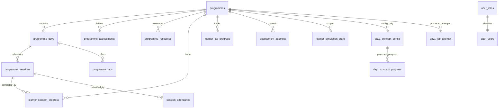

# Day 1 Data Model and Contracts

## Repository facts and constraints

The repository defines a normalized PostgreSQL schema in `supabase/migrations/20261115000001_initial_schema.sql`, seed data in `20261115000002_seed_initial_programme.sql`, RLS in `20261115000003_rls_policies.sql`, and role definitions in `20261115000004_auth_and_roles.sql`; `supabase/init_full_schema.sql` is a consolidated script. Do not add parallel tables or hand-edit migrations. Root `AGENTS.md` reserves schema changes to Lovable-managed tooling. First verify which schema is actually deployed and use managed schema workflows for an approved change.

The schema already has `programmes`, `programme_days`, `programme_sessions`, `programme_labs`, `programme_assessments`, `programme_resources`, `learner_session_progress`, `learner_lab_progress`, `session_attendance`, `assessment_attempts`, `learner_simulation_state`, and `user_roles`. Existing columns include JSONB assessment answers, session completion timestamps, lab checklist keys, and user/role identifiers. Reuse appropriate records; do not create duplicate programme/session/lab/assessment entities.

The application code currently persists a broad state object in browser localStorage and has no app auth/client module in the inspected `src/`. The SQL role table and policy functions are not proof that auth is connected to the running app. The RLS script allows the shared anonymous `local-learner` identity for guest progress; that is unsuitable as a multi-learner identity. The public read policy for published `programme_assessments` should not expose answer keys for a real assessment bank.

## Existing entities to reuse

| Need | Existing entity | Existing shape / caution |
| --- | --- | --- |
| Programme/day/session | `programmes`, `programme_days`, `programme_sessions` | Normalized keys and ordered rows already match programme config. Preserve current IDs for Day 2–Day 5. |
| Lab definitions | `programme_labs` | Title, day, instructions, checklist. The detailed deterministic lab engine contract exceeds current static checklist fields; keep authored lab specification/data centrally and add state only after schema review. |
| Assessment definitions | `programme_assessments` | Prompt, options, answer, order; current public-read policy exposes rows from published courses. Do not place unreleased keys in the learner-readable definition path. |
| Session completion | `learner_session_progress` | Composite user/programme/session identity and timestamp. Validate identity and current session before write. |
| Lab checklist state | `learner_lab_progress` | Currently stores one checkbox key/value, not a scored task submission. Do not overload it with attempt history. |
| Attendance | `session_attendance` | Staff-only policy exists in role migration; verify role and current deployed policies before use. |
| Assessment attempts | `assessment_attempts` | Stores score and answers JSONB, but lacks explicit assessment type, assessment ID, attempt number, pass state, and question-version contract. Avoid duplicate attempts by idempotency key in service behavior; schema evolution needs review. |
| Simulation controls | `learner_simulation_state` | Stores three simple flags; it is not a firewall configuration or live VM state. Keep Day 1's richer state isolated by lab/attempt. |
| Staff roles | `user_roles` | `student`, `instructor`, `administrator`; server-side role check required. The project currently lacks a verified sign-in flow. |

## Configuration as source of truth

`src/lib/training-platform.ts` is the current central configuration model. Extend it with versioned Day 1 content or a typed import from `docs/day1/data/day1-curriculum.json`. The application should not fetch or duplicate Day 1 names/counts in multiple views. Validate imported config atomically before updating the active programme. Keep session order and Day 1 schedule fields aligned with the existing programme IDs and seed.

For content authored in the repository, stable IDs in the JSON are the canonical import IDs. A proposed `concept` record contains: ID, session ID, ordering number, title, objectives, instructional fields, prerequisites, suggested duration, and lab references. `assessment` records need type, session/concept mapping, version, prompt, choices or rubric, points, explanation, publication status, and answer key with access restricted before submission. Lab definition records carry a fixture version and deterministic validator contract; attempts record results separately.

## Required learner records and ownership

- **Concept progress:** one per authenticated learner, programme, concept, with status, started/completed timestamps, check result reference, and content version. Unique key by learner/programme/concept; ignore removed IDs in current progress totals.
- **Assessment attempt:** reuse `assessment_attempts` only if the deployed schema and authorization model support required scope and idempotency. Persist learner ID, programme, assessment type and ID, attempt number, question-bank version, answers, score, pass, submitted timestamp. Do not write answer keys into learner records.
- **Lab attempt/submission:** require attempt ID, lab/config version, learner, attempt number, selected configuration, task results, score/pass, start/submit times, and reset boundary. Existing checklist state is not equivalent to this history.
- **Session progress:** reuse `learner_session_progress` after the configured completion rule passes; session status must be calculated from concept, assessment, and required-lab states.
- **Instructor access:** role-based access to cohorts and audit records must be explicit. Current schema does not define cohort enrollment or learner-to-instructor assignment; do not invent one. Until product requirements define enrollment scope, only authorized administrator-wide reporting or self-only learner access should be specified.

Potential new schema capabilities (concept records/progress and lab attempt history, assessment scope and attempt fields) are requirements to evaluate, not approved table names or migrations. Prefer versioned curriculum configuration in repository and reuse existing progress/attempt entities where they fit. If durable multi-user progress requires schema changes, request the managed backend/schema workflow and review RLS/grants before implementing.

## Proposed service contracts (logical, not existing APIs)

These are payload boundaries for future implementation, not current endpoints or route names:

- `loadDay1Curriculum(programmeId, dayId)` returns published lesson content with stable IDs and no answer keys.
- `saveConceptProgress(conceptId, status, checkAttemptId)` accepts only the authenticated learner's own record; server validates programme/session/prerequisites.
- `startAssessment(type, assessmentId)` returns eligible question prompt/version data with answer keys omitted.
- `submitAssessment(attemptId, responses)` validates ownership, attempt state, question version, response shape, and attempt rules; trusted scorer returns result and post-submit feedback.
- `startLab(labId)` creates an attempt from a server-controlled immutable fixture version; `submitLab(attemptId, responses)` computes task outcomes from that fixture, not client score.
- `loadInstructorProgress(scope)` requires a verified instructor/administrator role and an explicitly authorized learner scope.

Do not implement these as unauthenticated `/api/public/*` handlers returning learner records. If server logic is added, use the project's TanStack server-function conventions and authenticated middleware; public endpoints require their own caller verification.

## Validation and authorization

Validate IDs, foreign references, count constraints, unique ordering, date/time format, bounded duration, score 0–100, option indexes, answer schema, attempt ownership, and configuration version. RLS policies must match intended operation for each table; table grants are separate from RLS. Verify least privilege and deny-by-default grants. Roles cannot be trusted from client metadata; check the authoritative role row/function on the server. Do not use privileged admin clients to decide whether a caller is staff.

### Relationship diagram

`day1_concept_config`, `day1_concept_progress`, `day1_lab_attempt`, and `auth_users` in the diagram are logical placeholders, not inspected table names. No migration is supplied. Existing FKs/policies should be checked in the deployed schema before any implementation.

## Persistence and migration plan

1. First version of this package ships JSON curriculum content and local/demo progress only if no authenticated backend is enabled; display the local-only limitation.
2. For production persistence, verify managed backend connectivity, current schema, applied migrations, auth state, and RLS/grants. Do not infer the deployed schema from checked-in SQL.
3. Map concepts to stable config IDs and reuse existing entities when the deployed schema matches. Propose only the minimum managed schema evolution after checking existing constraints and policy behavior.
4. Backfill no fictional learner records. Preserve existing progress; provide an explicit migration/version policy for concept removal and content edits.
5. Verify read/write access as anonymous, learner, instructor, and administrator; verify one learner cannot read or write another learner's progress or submissions.
