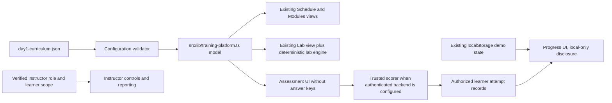

# Repository-Specific Implementation Plan

## Baseline inspected

- `/` is defined in `src/routes/index.tsx`; the route mounts `src/components/training-platform-app.tsx`. The generated route tree is `src/routeTree.gen.ts`; do not edit it manually.
- `src/lib/training-platform.ts` holds programme/session/day/lab/question/state types and the initial five-day programme. Keep this as the content source of truth.
- The app component owns current view state and actions; its views already cover Schedule, Learning Modules, Virtual Lab, Assessments, Progress, Instructor Console, and Administration.
- `src/styles.css` holds existing semantic tokens and styles; use those tokens and current responsive breakpoints.
- Browser state is stored under `shadowxlab-training-state-v1` in localStorage. SQL files describe a normalized schema and role policies; app-level auth/client integration was not found in `src/`.
- Dependencies already include React 19, TanStack Start/Router, lucide-react, zod, react-hook-form, shadcn/Radix UI components, and Vitest. Add no dependency until a concrete gap exists.

## Files to modify or create when implementing

The only files this documentation task creates are under `docs/day1/`. For a later app implementation, likely targets are:

- Modify `src/lib/training-platform.ts` for typed curriculum schema/import validation and a migration-safe progress model.
- Modify/extract focused pieces from `src/components/training-platform-app.tsx` for session concept disclosure, concept learning, lab attempts, assessment attempts, progress, and instructor presentation.
- Modify `src/styles.css` only for styles not already provided by semantic tokens and existing patterns.
- Add unit tests beside current `src/test/app-routing.test.tsx`, for example a dedicated content validation or scoring test under `src/test/`; exact names are proposed, not existing files.
- No new route is needed for the in-place workflow. If implementation later adds a path, add the TanStack file route and generated route tree through the normal generator, not by hand.
- Do not alter `supabase/migrations/*` or `supabase/init_full_schema.sql` directly. Schema changes are controlled by root `AGENTS.md` and require managed workflow.

## Existing components and behavior to reuse

Reuse the current `ScheduleView` day tabs/session rows, `ModulesView` selected-day pattern, `LabView` topology and simulation notice, `AssessmentsView` question rendering, `ProgressView`, and `InstructorView`. Reuse the current Button/Input/Textarea and card/heading patterns. Keep session IDs `d1-s1` through `d1-s4`, day ID `day-1`, current 10:00–17:00 timetable, and IDs for other days untouched. The existing quiz is only a demo with client-side answer keys; replace/extend only through an approved trusted scoring path for production assessment.

## Implementation order

1. **Configuration contract:** import curriculum JSON type; validate exact 48 concepts, 12/session, four lab references, session ordering/time consistency, unique IDs, prerequisite and lab references. Reject invalid file before state mutation.
2. **Content navigation:** expand Day 1 session with its 12 concepts; add focused concept reader and next/previous navigation, keeping selected programme/day/session stable.
3. **Progress calculation:** define concept/session/day denominator rules; exclude stale IDs; preserve existing untouched seeded progress behavior without treating its 42% as Day 1 concept achievement.
4. **Labs:** implement deterministic, fixture-bound state machines, explicit reset, scoped attempt status, testable validators, visible simulation-only label, and no arbitrary network destination input.
5. **Assessments:** author and validate question inventory; separate prompt delivery from answer keys; implement trusted scoring/persistence before claiming multi-user or secure assessment. If no verified auth/storage exists, label as local demonstration and do not expose it as confidential production assessment.
6. **Instructor access:** verify role and learner scope before adding controls or records. Never rely on hidden buttons or localStorage as access control. If identity and enrollment scope remain undefined, leave instructor learner records explicitly unimplemented rather than inventing access.
7. **Responsive/accessibility:** preserve current nav, add keyboard/accessibility support, test narrow and desktop widths, and honor reduced motion.
8. **Regression and content checks:** run `bunx vitest run` for relevant tests; run import/data invariant checks; manually verify existing programme CRUD, schedule, dashboard, and Day 2–Day 5 remained intact.
9. **Persistence only after approval:** inspect deployed schema, auth, grants, and RLS through managed tooling. No guessed migration or local SQL application.

## Architecture diagram

## Dependencies and technical risks

- **No verified backend/auth client:** SQL files alone do not create an app connection. Production ownership, assessment secrecy, and multi-user progress require an approved managed backend integration.
- **Answer-key exposure:** existing quiz configuration exposes `answer`; published SQL assessment rows are publicly readable under existing policy. Do not reuse that path for confidential assessment without fixing data projection and authorization.
- **Shared anonymous identity:** `local-learner` is not an individual learner. Do not report it as authenticated progress.
- **Schedule capacity:** one dedicated Day 1 lab session exists but four labs were requested; only two labs fit that block without changing supplied times. Keep the remaining two self-paced/embedded unless the instructor changes the schedule.
- **File size/maintainability:** current app view file is large. Prefer focused extraction only if implementation work requires it; preserve one shared model and do not create duplicate engines.
- **Content validation:** exact concept/question counts and every reference must be checked before import.

## Testing strategy

- Unit tests: curriculum shape and referential integrity; exactly 48 concepts and 12 per session; rules for completion denominators; stateless first-match and implicit deny; TCP state transitions and invalid tuple; NGFW result precedence; assessment score/attempt rules.
- Security tests: learner projection contains no answer key; role-gated actions reject guest/student callers; learner A cannot read learner B's progress; duplicate submit is idempotent.
- Integration tests: session selection → concept completion → lab attempt → session assessment → progress read-back; failure/retry/reset; imported configuration round-trip; local-only disclosure when backend absent.
- Regression tests: run existing route test plus application tests; verify programme CRUD/import/export, Day 2 dashboard and all five day tabs, mobile nav, and style build.
- Browser checks: 1280px and 375px viewports, keyboard-only path, long titles, loading/error/save failure states, reduced-motion preference.

## Definition of done

- Curriculum import validates 4 sessions, 48 unique concepts (12 each), and all lab references with no duplicate or orphan IDs.
- Each concept has all required instructional sections and display navigation remains in-session.
- Four labs produce deterministic, explainable results and never touch real infrastructure.
- Question counts and mappings validate; answer keys are absent from learner payload until submission.
- Progress and completion use active config and authorized learner records; no fake cross-user persistence.
- No Day 2–Day 5 content/schedule changes; existing navigation and views work.
- Access-denied and failed-save states are covered; UI is responsive and keyboard accessible.
- Tests/build pass; content owner approves all new question bank items and lab answer keys.
