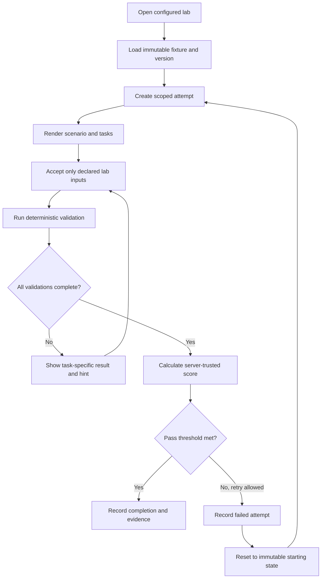

# Day 1 Virtual Labs

## Safety and execution model

All four exercises are deterministic software simulations using predefined, benign fixtures. They do not send packets, scan networks, run executables, connect to a firewall, or create a virtual machine. Controls mutate only the current lab attempt. Use the exact requirements below as the engine contract; no vendor CLI or real target is part of the lab.

Lab 01 and Lab 02 are associated with the supplied 11:45–13:00 lab session. Lab 03 is a self-paced simulation linked to the 14:00 stateful inspection lesson; Lab 04 is a self-paced simulation linked to the 15:45 NGFW lesson. Do not alter the supplied schedule to make room for these extensions.

## Shared lab record

Persist a lab attempt with stable `labId`, programme/day/session, learner scope, attempt number, started/submitted times, initial state version, answer/configuration snapshot, task results, score, and pass status. Treat a config version change as a new attempt context. Authoritative persistence and user identity depend on verified authentication; local-only mode must be labeled as browser-local. Do not trust a client-supplied score when durable or multi-user records are used.

## Lab 01 — Attack Surface & Threat Mapping

### Scenario and objectives

A fictional enterprise has a user zone, a public reporting service, a management interface, and an approved external dependency. Learners build a concise threat map using supplied inventory and flow facts. Objectives: identify assets and ownership; mark trust boundaries and exposure; distinguish fact from assumption; prioritize a threat; propose a least-privilege control and a verification check.

### Environment and initial state

- Fixed topology fixture: `USER-ZONE`, `DMZ`, `ADMIN-ZONE`, `INTERNET`; no real addresses route anywhere.
- Asset records: user workstation group, reporting service, management interface, and dependency endpoint; each includes owner, purpose, data class, and allowed-flow evidence.
- Three supplied observations: intended HTTPS access, an unowned management path, and a benign but undocumented flow.
- Initial threat map is empty; all tasks are incomplete.

### Student instructions and tasks

1. Assign each asset an owner and business purpose from the fixture.
2. Mark the public, user, and administration trust boundaries.
3. Classify the observed management path as confirmed exposure, not confirmed compromise.
4. Link one threat scenario to asset, boundary, impact, likelihood evidence, and confidence.
5. Select the narrowest proposed control and specify a positive and negative verification case.

### Topology and expected outcomes

Internet can reach only the reporting service's stated public listener in the intended state. The management interface belongs to the admin zone and has no public allow path. The learner identifies the unowned path as a reviewable exposure, not as proof of an attack. Every scenario has a trace to an asset, evidence, owner, control, and test.

### Validation and scoring

Score 100 points: asset ownership 15; boundary placement 20; fact-versus-assumption classification 15; threat linkage and confidence 20; scoped control 15; positive/negative validation 15. Pass at the configured 70% threshold. Validation checks IDs and selections against the fixture, not natural-language free text. Any task that asserts compromise without evidence receives no points for evidence classification.

### Hints and failure conditions

Hints reveal one missing relationship at a time. Fail a task if the learner treats an IP/alert as proof of actor identity, grants a public management path, or submits a threat with no asset. Failure is recoverable: revise and resubmit.

### Instructor solution, reset, completion

Instructor key: keep management access on ADMIN-ZONE; public reporting service is the only intended public path; classify the unowned management path as exposure requiring owner confirmation; prioritize by asset impact and confirmed reachability; verify allowed HTTPS succeeds while management access is denied and logged. Reset restores fixture, clears current task answers and score, and starts a new attempt; it must not delete unrelated progress. Completion requires all six validation categories and a passing score.

## Lab 02 — Firewall Rule Engineering

### Scenario, objectives, environment

Permit a documented user-to-reporting service flow while denying management access and unrelated services. Objectives: translate a requirement into a scoped rule; predict ordered first-match behavior; apply default deny; test positive and negative cases; interpret simulation logs. The environment contains one ordered rule list and benign packet-attribute fixtures only.

### Initial state and topology

- Zones: USER, DMZ, ADMIN, and EXTERNAL.
- Rule list starts empty; the terminal implicit action is `DENY`.
- The permitted fixture is USER to one DMZ reporting host over TCP/443.
- Negative fixtures include USER to ADMIN over TCP/22, USER to the reporting host on an unapproved port, and EXTERNAL to ADMIN.
- No other addresses, targets, packet generator, or arbitrary destination input is accepted.

### Rule-processing specification

The lab's own deterministic semantics are authoritative and deliberately small:

1. A candidate packet is a tuple: `direction, sourceZone, sourceAddress, destinationZone, destinationAddress, protocol, sourcePort, destinationPort`.
2. Rules are evaluated in ascending `order` (unique positive integer). An omitted match field is wildcard only when the author explicitly selects `ANY`; empty or malformed fields are invalid, not wildcards.
3. Match fields use exact zone, IPv4 CIDR membership, protocol, and inclusive destination-port range. Source port may be constrained but defaults to `ANY`.
4. The first fully matching rule decides `ALLOW` or `DENY`; evaluation stops. Later matches are shadowed for that tuple.
5. If no rule matches, implicit `DENY` decides. The simulator records `ruleId` or `implicit-deny`, matched fields, action, and explanation.
6. This lab is stateless: request and response packets are evaluated independently. Do not imply established-flow tracking here; Lab 03 supplies that behavior.
7. Malformed tuples or ports outside 0–65535 produce `INVALID_INPUT`, not an allow/deny policy result. Restrict user input to the supplied lab fixture to prevent arbitrary target or port testing.

### Student tasks and expected outcomes

1. Create the smallest allow rule for USER → reporting host, TCP, destination 443.
2. Run the allowed fixture and verify the intended explicit rule allows it.
3. Run all three negative fixtures and verify implicit or explicit deny.
4. Add an intentionally broad rule above a narrow deny, observe first-match shadowing, then repair the ordering/scope.
5. Export a readable rule rationale and test matrix in the attempt record.

Expected final result: one narrow allow; management, unrelated service, and external-to-admin flows denied; no unintended rule shadowing; each result has a clear decision reason.

### Validation, scoring, hints, failure

Score 100: scope 25; correct action/order 20; positive test 15; three negative tests 24 (8 each); shadowing diagnosis and repair 10; rationale 6. Passing threshold is configured by the course. Hints reveal tuple fields, then an example decision trace. Fail the run if a broad `ANY` rule permits management or if no default deny remains. No irreversible state: repair and rerun.

### Instructor solution, reset, completion

Instructor key: a USER-zone source CIDR to a single reporting host, DMZ destination, TCP/443, allow; follow with no broad allow; keep implicit deny last. Assert all negative fixtures denied. The deliberately broad earlier allow demonstrates that first-match policy makes the later management deny ineffective; remove/narrow/reorder and retest. Reset clears user-created rules, test results, and score, restoring the empty list and implicit deny. Completion requires all four expected decisions and passing score.

## Lab 03 — Network Segmentation & Stateful Firewall

### Scenario and topology

A user subnet communicates with a reporting service in the DMZ. The administration zone is isolated. Learners validate zone boundaries, address-plan consistency, forward and return routes, and a simplified stateful TCP exchange. All addresses are labels/fixture data and cannot reach the public network.

### Initial state

- USER and DMZ have non-overlapping fixture prefixes; ADMIN has no permitted user route.
- One route path is correct; a selectable fixture introduces an asymmetric return route.
- Firewall starts with one narrow USER → DMZ TCP/443 policy and state tracking enabled.
- Session table starts empty with a declared deterministic capacity and short teaching timeout.

### Student instructions and tasks

1. Assign supplied endpoints to the correct zones and verify prefixes do not overlap.
2. Trace the forward and reverse route; choose the correct return path.
3. Initiate a simulated TCP SYN matching the permitted flow; observe `NEW/SYN_SENT`.
4. Process only a reverse SYN-ACK with the matching endpoint tuple; observe `SYN_RECEIVED`.
5. Process the final forward ACK; observe `ESTABLISHED`.
6. Verify matching reply traffic is accepted by state while an unrelated inbound packet and ADMIN flow are denied.
7. Test FIN, RST, and idle timeout; observe close/reset/expired states.
8. Enable the asymmetric-route fixture and explain why the return packet is invalid at a device that did not see initiation.

### Simplified TCP/state model

- Session key: protocol plus both endpoint addresses and ports, canonicalized with an initiator direction and zone pair.
- Allowed matching SYN creates `SYN_SENT` with start and last-seen time.
- A reverse SYN-ACK with matching endpoints/transposed ports moves to `SYN_RECEIVED`.
- A matching final ACK from initiator moves to `ESTABLISHED`.
- Matching packets in an allowed established flow are accepted and refresh last-seen time.
- FIN moves to `CLOSING`; RST moves to `RESET` and closes the fixture; declared idle expiry moves to `EXPIRED` and removes active state.
- A wrong-tuple packet, unmatched ACK, unsolicited SYN-ACK, prohibited zone flow, or reply unseen by the enforcing device is `INVALID_STATE` or `DENIED` with a reason.
- UDP is a separate optional short-lived pseudo-state: allowed request creates tuple-bound temporary state; only matching response before timeout is accepted. It is not a transport handshake.
- These rules are a teaching model; they do not implement TCP sequence numbers, retransmission, fragments, NAT, real timeouts, or a network stack.

### Validation and scoring

Score 100: correct zone/prefix 15; forward and return route 15; handshake sequence 25; tuple-matched reply 15; denied unrelated/ADMIN flows 10; teardown and expiry 10; asymmetric-path diagnosis 10. Passing uses the configured threshold. The simulator validates deterministic transitions and does not grade claims about live packets.

### Hints, failure, instructor solution, reset

Hints identify the packet direction, then the expected prior state. Fail only the affected task for wrong transition, wrong tuple, or a broad zone bypass; allow correction. Instructor key: maintain non-overlapping USER/DMZ/ADMIN; symmetric route through the state-owning firewall; only the permitted tuple establishes; reply packets require a matching state; ADMIN and unrelated inbound remain denied. Reset restores addresses, routes, rule, empty session table, and counters; it must not clear learner's other lab attempts. Complete when all required transitions and negative cases pass.

## Lab 04 — NGFW Architecture & Security Policy

### Scenario and environment

Learners process a small set of safe, pre-authored flow fixtures through a published NGFW policy pipeline. Fixtures include an authorized application with matching identity, a wrong identity, an unknown application classification, an inspection result marked block, and a review-required result. No payload bytes, malware sample, live DPI, or external intelligence feed is processed.

### Initial state and student tasks

Initial policy permits a narrow service flow by zone/tuple; one required identity condition and one inspection profile are attached. Learners:

1. Identify which facts are supplied by network fields versus identity or application context.
2. Evaluate each fixture through parsing/normalization, zone, ordered network rule, identity/application conditions, inspection profile, and final decision.
3. Distinguish allow, deny, and review-required; cite the first failed condition.
4. Repair one narrowly scoped policy error, keeping default deny and logging a decision reason.
5. Compare a tuple-only decision with a context-aware decision and state visibility limits.

### Deterministic processing order

1. Validate fixture shape and normalize declared fields.
2. Resolve ingress/egress zones.
3. Evaluate network rules by first-match semantics; unmatched means deny.
4. Evaluate required identity and application context; missing required context fails closed to the configured deny/review outcome.
5. Apply the attached inspection fixture: `clear`, `block`, or `review` with declared confidence.
6. Final precedence: explicit network deny → deny; required identity failure → deny; inspection `block` → deny; inspection `review` → review (not allow); otherwise allow only if all required conditions passed.
7. Produce a structured reason with stage, policy ID, and fixture ID. No answer key or hidden expected result appears before attempt submission.

### Expected outcomes, scoring, and safety

Score 100: stage identification 20; five fixture decisions 40; first-failed-condition explanations 15; least-privilege repair 15; limitations and evidence statement 10. Configured pass score applies. A stage result is simulated data and never described as a real inspection, malware scan, or user authentication event.

Hints reveal the stage definitions and one trace at a time. Failure conditions: allowing a block fixture, treating review as allow, or bypassing a failed identity condition with a global allow. Learner can reset and retry.

### Instructor solution and reset

Instructor key: tuple-only data cannot establish user identity or a specific application; only the supplied fixture can. Deny wrong identity and inspection block; hold review-required for review; allow only the fixture that satisfies zone, first-match network policy, required context, and clear inspection result. Keep unknown classification denied or in review per configured policy. Reset restores the original rules and fixture queue, clears only this attempt, and records an attempt boundary. Completion requires every fixture decision correct, the policy repair validated by positive and negative tests, and a passing score.

## Lab execution workflow

