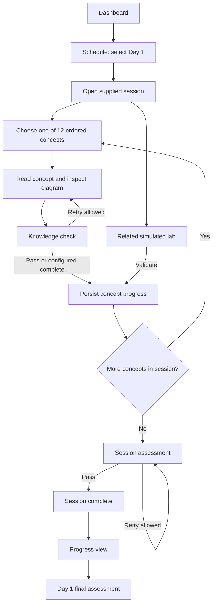
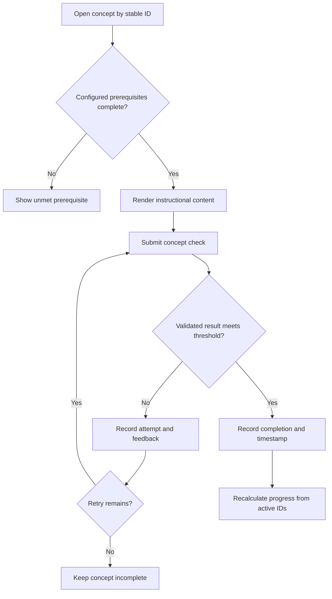
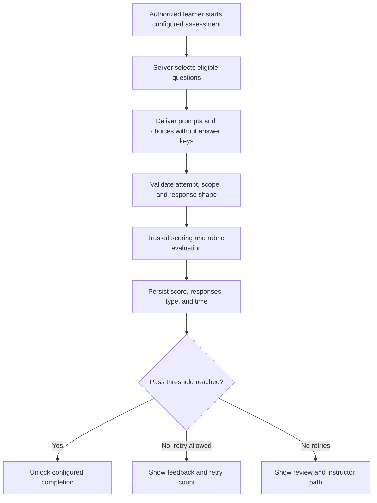
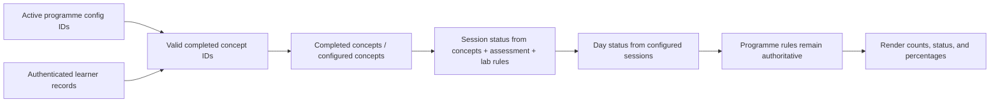

# Day 1 Product Specification

## Status and scope

This document specifies a proposed Day 1 extension to the audited ShadowXLab app. It is not a statement that the new experience exists today. Preserve the current programme, sidebar, dashboard, and Day 2–Day 5 data. Extend the centralized programme and state model in `src/lib/training-platform.ts`, and integrate with the single existing `/` route and views in `src/components/training-platform-app.tsx`.

### Day 1 definition

- Programme: Firewall & VPN Security Administration.
- Day: Security & Firewall Foundations.
- Instructor: Naveen Kumar Yadav Loya.
- Four sessions and times are defined in [the curriculum JSON](./data/day1-curriculum.json), matching the seeded schedule.
- 48 concepts, exactly 12 per session, in supplied topic scope.
- Four simulated labs: Attack Surface & Threat Mapping; Firewall Rule Engineering; Network Segmentation & Stateful Firewall; NGFW Architecture & Security Policy.
- Assessments: 240 concept-question capacity, 80 session-question capacity, 40 final-question capacity.

## Learner requirements

1. From Dashboard or Schedule, select Day 1 and open its existing session without losing the selected programme or day.
2. See the four supplied sessions in original order and times. Expand a session to view its 12 ordered concepts, completion state, related lab, and assessment entry point.
3. Open a concept, navigate next/previous within that session, review all instructional fields, and mark it complete only after the learner confirms completion or passes the configured knowledge check.
4. Open an associated simulated lab, read scenario and constraints, complete tasks, receive deterministic validation feedback, and reset to the initial lab state.
5. Submit a concept, session, or final assessment. Show score, per-question feedback after submission, pass/fail, attempt, and a clear retry path according to instructor policy.
6. See progress by concept, session, lab, and assessment; progress must be derived from records and configuration, not an arbitrary dashboard constant.
7. Refresh or reopen and retain the same learner's progress if an authenticated persistent store is actually integrated. In local-only mode, disclose browser-local storage and do not imply cross-device or multi-user persistence.

## Instructor requirements

- Maintain configured content and ordering; preview as learner; review completion, attempts, scores, lab evidence, and timestamps by learner; export a scoped report only when authorized.
- Set publish state, pass score, attempt policy, retries, and whether knowledge checks are required for concept completion.
- Do not permit an instructor action solely because a control is visible in the current unauthenticated dashboard. Require a verified instructor/administrator role before reading or changing learner records or answer keys.
- Every instructor action that changes attempts, completion, policy, or content has actor, time, scope, and outcome evidence.

## Content and assessment rules

- All Day 1 material comes from the supplied Day 1 topics. No later-day module, vendor feature, real attack, or appliance command is introduced as a Day 1 requirement.
- Content and learning objects load by stable IDs from configuration. Do not encode concept names/counts in view conditionals.
- Each session has 12 concepts in the authored sequence. The learner may review earlier concepts; prerequisite rules should block only forward completion checks when the configured prerequisite has not been satisfied.
- Current application has a four-item programme quiz with client-visible `answer` values in `src/lib/training-platform.ts`. That is a demo implementation and must not be reused as the secure Day 1 assessment pattern. Before production use, answer keys must remain server-side and assessment submission must be validated by a trusted server/data boundary. Existing SQL's public read policy on published `programme_assessments` is another exposure to resolve or avoid for confidential answer keys.
- Assessment capacities are exact: five concept questions per concept = 240; 20 session questions per session = 80; 10 final questions per session = 40. A question is tagged with exactly one concept and one assessment type; final questions are distributed 10 per session. The JSON currently specifies counts and sample data model rather than supplying all 360 questions.
- Use 70% as initial pass-score proposal matching the existing programme completion rule. Instructors can configure it. Do not silently turn this into a universal fixed platform rule.
- Question types: single-best-answer, multi-select with partial-credit rule stated before attempt, sequence/order, and short scenario response with rubric. Maintain clear equivalent feedback for keyboard and screen-reader users.

## Completion and progress logic

- Concept completion: learner explicitly marks reviewed and meets the configured check threshold; store completed status and timestamp. A revisit does not erase completion.
- Session completion: all configured concepts complete and the required session assessment is passed. If the instructor disables either requirement, use that programme configuration and show the resulting rule.
- Day completion: all configured sessions complete, including the existing timetable sessions, subject to the course completion settings. Labs count only if the configuration marks them as required.
- Programme completion continues to follow `completionRules`; do not change it as part of this Day 1 expansion.
- Progress panel displays numerator/denominator and a percentage derived from valid active configuration records. If no concepts are complete, show 0 for the Day 1 concept measure. Preserve the existing 42% initial dashboard reference only for its currently seeded untouched state; do not use it as earned Day 1 progress.
- Editing/removing a concept does not silently transfer its completion to a different concept ID. Orphaned progress is excluded from totals and retained/handled according to an explicit archive policy.

## Access control, privacy, and safety

- Day 1 lesson text and published curriculum may be readable by a learner. Private learner progress is only readable to that learner and authorized staff; answer keys and unreleased assessment questions are not learner-readable before submission.
- Instructor controls require server-verified role checks. The inspected app has no sign-in interface or client integration; SQL role definitions alone do not establish a protected application.
- Do not rely on the SQL policy that assigns anonymous progress to the shared `local-learner` identity for multi-user learning data. Local-only mode is a clearly labeled single-browser demonstration.
- Lab environments are deterministic simulations over supplied fixtures. No real packet is sent, no host is scanned, no command is executed, and no live firewall or VM is controlled.
- Collect only assessment and progress facts needed for training. Display a concise notice before storing or exporting learner records.

## States and failure behavior

- Empty: no concepts/labs configured; provide an authorized configuration action and avoid broken navigation.
- Loading: retain selected day/session context, show content-shaped placeholders, disable submission until required data is ready.
- Offline/failed save: preserve unsent work in local pending state where safe; show that it is not yet synced and provide retry. Never show “saved” on a failed write.
- Invalid configuration: reject import with field path and reason; do not partially replace the active configuration.
- Missing prerequisite or lab dependency: show the named unmet requirement and a link to it.
- Assessment failure: show score, missed concept references, remaining attempts, and retry availability without exposing correct answers before submission.
- Unauthorized instructor action: deny server-side and explain that the account lacks access; hiding the control is supplementary, not enforcement.
- Stale or removed content: preserve a safe progress history reference and prevent an obsolete concept from inflating current completion.

## Responsive and accessibility requirements

- Preserve desktop sidebar and existing mobile navigation. At narrow widths, sessions and concepts become single-column, controls wrap without clipping, and the next/previous concept controls remain visible.
- Use semantic headings, ordered lists, labels, accessible names, keyboard-operable accordions and tabs, visible focus, status announcements, and text labels in addition to color.
- Respect reduced-motion settings and avoid relying on glow, color, or icon shape alone to convey completion or error.
- Long concept titles, answers, and lab outcomes wrap without horizontal page scrolling.

## Assumption register and gaps

1. The repository confirms four Day 1 timetable blocks and one scheduled lab block (11:45–13:00). The requested four labs cannot all receive dedicated timetable time without a schedule change. This blueprint links Lab 01/02 to the morning lab window and Lab 03/04 to their matching afternoon lessons as optional embedded/self-paced simulations. The instructor must decide whether to reserve further delivery time; this package does not change the timetable.
2. The 70% threshold is taken from the existing seed completion rules; instructor configurability is required.
3. The product requirements specify question-bank sizes but do not ask for all 360 bank items in this package. This package provides a concrete blueprint and sample bank with answers; full bank authoring and review remains a content-production task.
4. SQL files exist in the repo, but the connection and whether scripts are applied are unverified. No new migration is prescribed.
5. Existing app progress is localStorage-based, and the app has no verified login. An authenticated persistent implementation depends on connecting/configuring the managed backend and verifying the role model before deployment.

## Learning navigation and learner journey

## Workflow diagrams

### Concept completion

### Assessment workflow

### Progress calculation

