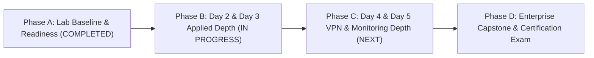

# ShadowXLab Cyber Academy — Firewall & VPN Security Administration
# Phase 11: Implementation Roadmap & Architecture Preservation

This roadmap governs the systematic enhancement of the ShadowXLab Cyber Academy. It strictly enforces architectural continuity and backward compatibility.

---

## 1. Hard Architectural Guardrails

Under no circumstances should the curriculum enhancement:
1. **Rebuild the Platform**: The TanStack Start + Nitro Cloudflare Worker + React architecture is frozen and production-proven.
2. **Redesign the UI**: The established dark cyber-theme, fixed 238px sidebar, topbar metadata chips, and responsive grids must remain intact.
3. **Alter Authentication / RLS**: Supabase Auth, Row-Level Security policies, and student/instructor role boundaries must remain untouched.
4. **Remove Existing Content**: Day 2–Day 5 timetable entries must be enriched and deepened, not deleted or overwritten.
5. **Fabricate Execution**: Browser simulations must never claim real IPsec tunnels or real kernel packet filtering.

---

## 2. Staged Implementation Phases

### Phase A: Lab Baseline & Readiness (COMPLETED & DEPLOYED)
- **Status**: **LIVE on `https://sxl-net.shadowxlab.com`**
- **Artifacts**:
  - `src/components/lab-readiness/lab-readiness-center.tsx`: Hardware calibration, 4 tiers, ticket dispatch.
  - `src/components/lab-readiness/standard-pfsense-lab.tsx`: Standardized SXL-LAN topology and terminal verification.
  - `src/components/lab-readiness/lab-troubleshooting-wizard.tsx`: 8-step decision tree.
  - `src/components/lab-readiness/instructor-lab-readiness-panel.tsx`: Live student roster & queue.
  - High-DPI transparent logo deployed.
  - Vitest test suite: 72/72 tests passing.

### Phase B: Day 2 & Day 3 Curriculum Enrichment (Recommended Next Step)
- Author `day2-curriculum.json` (48 concepts across Sessions 2.1–2.4).
- Author `day2-assessment-bank.json` (240 concept checks + 80 session questions + 40 final questions).
- Author `day3-curriculum.json` and assessment bank for NAT and VPN cryptographic foundations.
- Add practical walkthroughs for DMZ interface creation and Inbound Port Forwarding.

### Phase C: Day 4 & Day 5 Applied Engineering Depth
- Author `day4-curriculum.json` (OpenVPN Server PKI, WireGuard, and XML config recovery).
- Author `day5-curriculum.json` (Filterlog decoding, live packet capture triage, Suricata IPS).
- Implement 50-Question Final Certification Assessment.
