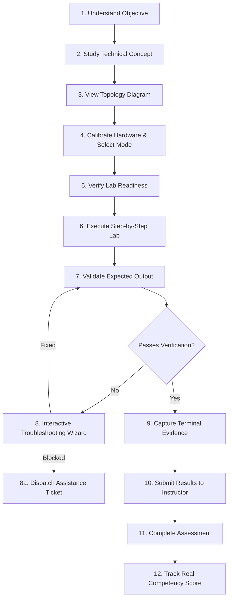

# ShadowXLab Cyber Academy — Firewall & VPN Security Administration
# Phase 9: Student Learning Experience & Lifecycle Audit

This audit examines the friction points and cognitive load experienced by corporate students progressing through the platform.

---

## 1. The 12-Step Student Learning Journey

The ShadowXLab student workflow is audited against the complete 12-stage enterprise training lifecycle:

---

## 2. Friction Points & UX Recommendations

| Stage | Observed Student Friction | Implemented / Recommended Mitigation | Status |
| :--- | :--- | :--- | :--- |
| **Hardware Setup** | Laptop freezes running 3 GUI VMs; RAM exhaustion. | Added **Lab Readiness Center** with 4 execution modes (Modes A, B, C, D) and RAM sliders. | **IMPLEMENTED** |
| **VirtualBox NICs** | Case-sensitivity mismatch (`SXL-LAN` vs `sxl-lan`) causing zero DHCP leases. | Added copyable VBoxManage setup commands and explicit case-sensitivity alerts. | **IMPLEMENTED** |
| **pfSense Console** | Confusion during initial interface assignment (inverting WAN and LAN). | Created clear Option 1 and Option 2 numbered walkthroughs with expected prompt texts. | **IMPLEMENTED** |
| **Troubleshooting** | Instructor overwhelmed by 10 students asking the same DHCP question. | Built **Lab Troubleshooting Wizard** with an 8-step self-service decision tree. | **IMPLEMENTED** |
| **Command Typos** | Students miskeying complex BPF filters or routing commands. | Integrated 1-click **Copy to Clipboard** buttons on all practical commands. | **IMPLEMENTED** |
| **Proof of Competency** | Students marking checkboxes without actually performing the lab. | Enforced **Terminal Evidence Submission** requiring actual CLI terminal paste. | **IMPLEMENTED** |
| **Days 2–5 Navigation** | ModulesView for Days 2–5 only shows bullet points with no deep explanations. | Expand Day 2–5 curriculum structure to match Day 1's rich concept panel. | **RECOMMENDED ROADMAP** |
