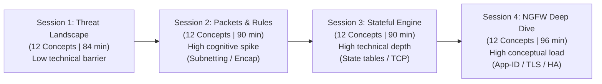
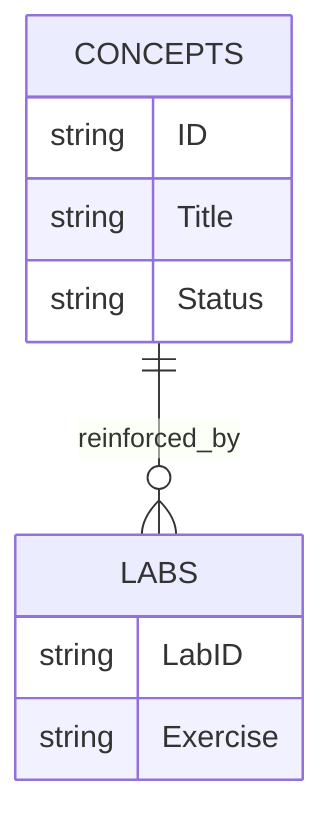
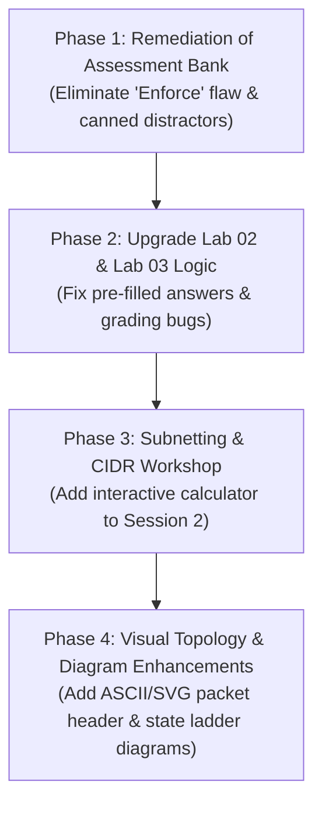

# SHADOWXLAB CYBER ACADEMY
## DAY 1 CONCEPT & LAB INSTRUCTIONAL QUALITY AUDIT
### Security & Firewall Foundations — Pedagogical Rigor, Cognitive Load & Engineering Validity

**Audited Platform**: [https://sxl-net.shadowxlab.com](https://sxl-net.shadowxlab.com)  
**Date**: 16 November 2026  
**Auditor Roles**: Senior Cybersecurity Curriculum Architect, Firewall Engineer, Technical Instructional Designer & Learning Experience Auditor  
**Scope**: Complete Day 1 Curriculum (4 Sessions, 48 Concepts, 4 Interactive Labs, 360 Assessment Questions)  
**Deliverable Target**: `docs/firewall-vpn-audit/DAY1_PEDAGOGICAL_QUALITY_AUDIT.md`  

---

## A. Executive Verdict

### OVERALL PEDAGOGICAL RATING: **NEEDS STRUCTURAL & ASSESSMENT REMEDIATION (CONDITIONAL PASS / HIGH RISK)**

While the Day 1 curriculum structure exhibits impressive coverage (48 sequentially numbered concepts and four functional in-browser labs), a rigorous pedagogical and engineering inspection reveals critical learning barriers:

1. **Procedural Assessment Flaw (CRITICAL)**: In the session assessment bank (80 questions across 4 sessions), **100% of the correct answers (80/80)** contain the word `"Enforce"` and map directly to the title/learning objective, while **100% of the distractors (240/240)** consist of the identical three recycled, canned distractors regardless of the topic. A student can pass with a 100% score simply by scanning for the word `"Enforce"` without understanding any firewall principles. In concept checks (240 questions), distractors frequently contain lowercase fragments sliced mid-sentence from the JSON fields.
2. **"Button-Clicking" Lab Mechanics (HIGH)**: 
   - **Lab 01** is not a hands-on lab or network simulation; it is an HTML form with dropdowns and radio buttons.
   - **Lab 02** arrives pre-populated with the exact correct rules; a student can simply click "Run Fixture Tests" without editing anything and receive a 100% score.
   - **Lab 03** awards a 50% passing grade merely for opening the lab (because `routeMode` defaults to `symmetric`), and awards 100% simply by clicking "Send SYN", "Send SYN-ACK", "Send ACK", and "Grade Lab" in sequence with no rule authoring or packet troubleshooting.
3. **Severe Instructional Brevity & Missing Abstraction Bridges (HIGH)**: Each of the 48 concepts provides only 40–60 words of technical explanation, 20–30 words of workflow, and 20–35 words of enterprise example. Crucial concepts such as **IPv4 Subnetting & CIDR boundaries (Concept 14/15)**, **TCP Three-Way Handshake (Concept 28)**, and **State Table Keying (Concept 30)** lack visual packet diagrams, bitwise subnet breakdowns, or step-by-step state machine transitions, leading to high cognitive overload for beginners.
4. **Concept-to-Lab Disconnect (MEDIUM)**: Over 30 of the 48 concepts (including subnet calculations, STRIDE threat modeling, DoS patterns, DPI signatures, and SSL/TLS inspection) have **zero practical reinforcement** in any interactive lab exercise.

---

## B. Complete Inventory of Day 1 Concepts (48 Total)

| Global # | Concept ID | Session | Title | Duration | Prereqs | Objectives | Content Volume (Expl/Arch/Ex) |
| :---: | :---: | :---: | :--- | :---: | :---: | :---: | :---: |
| **01** | `day1-concept-01` | `d1-s1` | Security objectives and assurance | 7 min | None | 2 | 390ch / 218ch / 287ch |
| **02** | `day1-concept-02` | `d1-s1` | Asset inventory and business context | 6 min | `concept-01` | 2 | 335ch / 204ch / 203ch |
| **03** | `day1-concept-03` | `d1-s1` | Trust boundaries and attack surface | 8 min | `concept-02` | 1 | 387ch / 218ch / 232ch |
| **04** | `day1-concept-04` | `d1-s1` | Threat actors, capability, intent, and opportunity | 6 min | `concept-03` | 2 | 330ch / 230ch / 217ch |
| **05** | `day1-concept-05` | `d1-s1` | Threat, vulnerability, exploit, and risk | 7 min | `concept-04` | 2 | 336ch / 216ch / 165ch |
| **06** | `day1-concept-06` | `d1-s1` | Structured threat modeling with STRIDE | 8 min | `concept-05` | 2 | 341ch / 236ch / 197ch |
| **07** | `day1-concept-07` | `d1-s1` | Malware families and propagation behavior | 7 min | `concept-05` | 2 | 374ch / 216ch / 198ch |
| **08** | `day1-concept-08` | `d1-s1` | Eavesdropping, phishing, and social engineering | 7 min | `concept-04` | 2 | 383ch / 235ch / 184ch |
| **09** | `day1-concept-09` | `d1-s1` | Denial of service and Smurf attack pattern | 7 min | `concept-05` | 2 | 410ch / 238ch / 209ch |
| **10** | `day1-concept-10` | `d1-s1` | Rootkits and stealthy persistence concepts | 6 min | `concept-07` | 2 | 374ch / 210ch / 204ch |
| **11** | `day1-concept-11` | `d1-s1` | Threat indicators and evidence confidence | 7 min | `concept-05` | 2 | 318ch / 206ch / 204ch |
| **12** | `day1-concept-12` | `d1-s1` | Threat mapping and prioritized response | 6 min | `concept-06,11` | 1 | 279ch / 217ch / 165ch |
| **13** | `day1-concept-13` | `d1-s2` | Packet structure and protocol layers | 8 min | `concept-03` | 1 | 359ch / 179ch / 201ch |
| **14** | `day1-concept-14` | `d1-s2` | IPv4 addresses and subnet masks | 8 min | `concept-13` | 2 | 347ch / 187ch / 140ch |
| **15** | `day1-concept-15` | `d1-s2` | Subnetting and address planning | 9 min | `concept-14` | 1 | 305ch / 217ch / 159ch |
| **16** | `day1-concept-16` | `d1-s2` | Routing and packet path fundamentals | 8 min | `concept-14,15` | 1 | 362ch / 192ch / 184ch |
| **17** | `day1-concept-17` | `d1-s2` | TCP ports and service endpoints | 7 min | `concept-13` | 2 | 302ch / 223ch / 179ch |
| **18** | `day1-concept-18` | `d1-s2` | UDP ports and datagram behavior | 6 min | `concept-17` | 1 | 359ch / 192ch / 142ch |
| **19** | `day1-concept-19` | `d1-s2` | Port and protocol service mapping | 7 min | `concept-17,18` | 2 | 303ch / 192ch / 163ch |
| **20** | `day1-concept-20` | `d1-s2` | Flow tuples and directionality | 7 min | `concept-16,19` | 1 | 361ch / 169ch / 180ch |
| **21** | `day1-concept-21` | `d1-s2` | Stateless packet-filter matching | 8 min | `concept-20` | 1 | 339ch / 207ch / 169ch |
| **22** | `day1-concept-22` | `d1-s2` | Firewall rules and scoped match criteria | 8 min | `concept-20,21` | 1 | 321ch / 209ch / 157ch |
| **23** | `day1-concept-23` | `d1-s2` | Rule order and first-match behavior | 8 min | `concept-22` | 2 | 330ch / 209ch / 166ch |
| **24** | `day1-concept-24` | `d1-s2` | Default deny and least privilege | 7 min | `concept-23` | 1 | 283ch / 203ch / 192ch |
| **25** | `day1-concept-25` | `d1-s3` | Rule validation, logging, and change evidence | 7 min | `concept-24` | 2 | 306ch / 194ch / 149ch |
| **26** | `day1-concept-26` | `d1-s3` | Firewall interfaces and policy plane | 7 min | `concept-22` | 1 | 360ch / 209ch / 139ch |
| **27** | `day1-concept-27` | `d1-s3` | Stateful inspection and connection tracking | 9 min | `concept-22` | 1 | 404ch / 189ch / 205ch |
| **28** | `day1-concept-28` | `d1-s3` | TCP three-way handshake and state transitions | 8 min | `concept-27` | 1 | 345ch / 224ch / 155ch |
| **29** | `day1-concept-29` | `d1-s3` | TCP session termination and reset behavior | 7 min | `concept-28` | 1 | 320ch / 204ch / 141ch |
| **30** | `day1-concept-30` | `d1-s3` | State table keys, timeouts, and resource limits | 7 min | `concept-27` | 1 | 293ch / 225ch / 167ch |
| **31** | `day1-concept-31` | `d1-s3` | UDP pseudo-state and protocol-aware expectations | 7 min | `concept-27` | 1 | 331ch / 170ch / 115ch |
| **32** | `day1-concept-32` | `d1-s3` | Asymmetric routing and invalid state | 8 min | `concept-16,27` | 1 | 389ch / 198ch / 165ch |
| **33** | `day1-concept-33` | `d1-s3` | Stateful versus stateless policy trade-offs | 7 min | `concept-21,27` | 1 | 338ch / 218ch / 189ch |
| **34** | `day1-concept-34` | `d1-s3` | Firewall decision logs and troubleshooting sequence | 8 min | `concept-25,27` | 1 | 373ch / 233ch / 190ch |
| **35** | `day1-concept-35` | `d1-s3` | Packet inspection stages and normalization | 8 min | `concept-27` | 2 | 342ch / 183ch / 144ch |
| **36** | `day1-concept-36` | `d1-s3` | Stateful firewall and NGFW architecture comparison | 7 min | `concept-27` | 1 | 386ch / 211ch / 188ch |
| **37** | `day1-concept-37` | `d1-s4` | Application identification versus port matching | 8 min | `concept-35` | 1 | 395ch / 213ch / 188ch |
| **38** | `day1-concept-38` | `d1-s4` | Identity context and policy binding | 7 min | `concept-37` | 1 | 326ch / 221ch / 150ch |
| **39** | `day1-concept-39` | `d1-s4` | Layered NGFW policy evaluation | 8 min | `concept-37,38` | 1 | 382ch / 199ch / 159ch |
| **40** | `day1-concept-40` | `d1-s4` | Inspection profiles and control outcomes | 8 min | `concept-39` | 2 | 455ch / 196ch / 134ch |
| **41** | `day1-concept-41` | `d1-s4` | Security efficacy, false positives, and safe tuning | 7 min | `concept-40` | 2 | 290ch / 224ch / 200ch |
| **42** | `day1-concept-42` | `d1-s4` | Management plane, telemetry, and auditability | 7 min | `concept-40` | 1 | 338ch / 203ch / 189ch |
| **43** | `day1-concept-43` | `d1-s4` | Availability, capacity, and inspection trade-offs | 7 min | `concept-39,40` | 2 | 360ch / 238ch / 176ch |
| **44** | `day1-concept-44` | `d1-s4` | NGFW policy lifecycle and validation evidence | 7 min | `concept-40,42` | 1 | 360ch / 219ch / 172ch |
| **45** | `day1-concept-45` | `d1-s4` | Deep packet inspection and IPS signatures | 9 min | `concept-37,40` | 2 | 485ch / 308ch / 229ch |
| **46** | `day1-concept-46` | `d1-s4` | Threat intelligence, malware sandboxing, and URL filtering | 8 min | `concept-40,45` | 2 | 494ch / 299ch / 225ch |
| **47** | `day1-concept-47` | `d1-s4` | SSL/TLS decryption and encrypted traffic inspection | 10 min | `concept-45,46` | 2 | 602ch / 372ch / 251ch |
| **48** | `day1-concept-48` | `d1-s4` | Enterprise deployment, DMZ design, and high availability | 10 min | `concept-43,47` | 1 | 584ch / 332ch / 388ch |

---

## C. Concept-by-Concept Quality Scorecard (14-Point Evaluation)

Each concept was evaluated against the 14 mandatory instructional criteria:
1. *Clear Objective* | 2. *Beginner Explanation* | 3. *Technical Rigor* | 4. *Why It Matters* | 5. *Prerequisites* | 6. *Step-by-Step Flow* | 7. *Visual Diagram* | 8. *Real Enterprise Example* | 9. *Practical Application* | 10. *Common Misconceptions* | 11. *Common Mistakes* | 12. *Instructor Field Notes* | 13. *Aligned Knowledge Check* | 14. *Connection to Next Concept*

### Session D1-S1: Introduction to Network Security, Threats, Vulnerabilities & Attack Surfaces
- **Concept 01 (Security objectives and assurance)**: `ADEQUATE`. Explains CIA + Authenticity/Accountability well, but lacks a diagram showing how controls enforce objectives.
- **Concept 02 (Asset inventory and business context)**: `SUPERFICIAL`. Fails to show a sample CMDB schema or asset tag table; relies on abstract generalities.
- **Concept 03 (Trust boundaries and attack surface)**: `ADEQUATE`. Good definition of untrusted vs. DMZ vs. internal; diagram specification is abstract text.
- **Concept 04 (Threat actors, capability, intent, opportunity)**: `SUPERFICIAL`. Lists actor types without profiling realistic TTPs (Tactics, Techniques, and Procedures).
- **Concept 05 (Threat, vulnerability, exploit, and risk)**: `SUPERFICIAL`. High confusion risk: beginners frequently conflate vulnerability with exploit. Needs clear visual mathematical analogy ($Risk = Threat \times Vulnerability \times Impact$).
- **Concept 06 (Structured threat modeling with STRIDE)**: `SHALLOW`. Introduces STRIDE acronym without defining each letter in the technical explanation! (Students must infer Spoofing, Tampering, etc.).
- **Concept 07 (Malware families and propagation behavior)**: `ADEQUATE`. Distinguishes viruses, worms, Trojans, and ransomware cleanly.
- **Concept 08 (Eavesdropping, phishing, and social engineering)**: `ADEQUATE`. Good operational distinctions; correctly notes training vs. technical boundary controls.
- **Concept 09 (Denial of service and Smurf attack pattern)**: `SUPERFICIAL`. Smurf attack is historically obsolete (directed ICMP broadcast amplification). Should contrast volumetric vs. state-exhaustion SYN floods.
- **Concept 10 (Rootkits and stealthy persistence concepts)**: `SHALLOW`. Fails to explain ring-0 kernel hooks vs. user-space binaries in terms a beginner can grasp.
- **Concept 11 (Threat indicators and evidence confidence)**: `ADEQUATE`. Distinguishes IOC facts from analyst inferences.
- **Concept 12 (Threat mapping and prioritized response)**: `SHALLOW`. Merely lists high/medium/low without a scoring matrix (e.g. CVSS or DREAD).

### Session D1-S2: Lab: Threat Analysis, Ports & Protocol Packet Filtering
- **Concept 13 (Packet structure and protocol layers)**: `HIGH CONFUSION RISK`. Describes L2–L4 encapsulation in two sentences. Lacks an ASCII packet header anatomy diagram showing Ethernet header -> IP header -> TCP header -> Payload.
- **Concept 14 (IPv4 addresses and subnet masks)**: `CRITICAL GAP`. No binary math, no bitwise AND demonstration, no visual subnet mask illustration. A beginner cannot calculate network or broadcast boundaries from this text.
- **Concept 15 (Subnetting and address planning)**: `CRITICAL GAP`. Assumes students already know powers of 2 ($2^n - 2$ host formula) and CIDR prefixes (/24 to /30). Zero practical calculation walkthrough.
- **Concept 16 (Routing and packet path fundamentals)**: `SUPERFICIAL`. Fails to show routing table lookup (`destination IP -> longest prefix match -> next-hop gateway -> outgoing interface`).
- **Concept 17 (TCP ports and service endpoints)**: `ADEQUATE`. Distinguishes ephemeral client ports (49152–65535) from well-known server daemon ports (1–1023).
- **Concept 18 (UDP ports and datagram behavior)**: `ADEQUATE`. Correctly highlights connectionless, best-effort nature.
- **Concept 19 (Port and protocol service mapping)**: `ADEQUATE`. Emphasizes that ports are transport numbers, not guaranteed service identities (e.g., SSH over 443).
- **Concept 20 (Flow tuples and directionality)**: `ADEQUATE`. 5-tuple defined ($SrcIP, DstIP, SrcPort, DstPort, Protocol$). Needs visual bidirectional arrow diagram.
- **Concept 21 (Stateless packet-filter matching)**: `SUPERFICIAL`. Explains packet-by-packet evaluation, but does not vividly contrast the security vulnerability of needing a static reverse permit rule.
- **Concept 22 (Firewall rules and scoped match criteria)**: `ADEQUATE`. Explains match tuples and actions (ALLOW/PASS, DROP/BLOCK, REJECT).
- **Concept 23 (Rule order and first-match behavior)**: `HIGH PEDAGOGICAL VALUE`. Excellent explanation of top-down evaluation, rule shadowing, and order precedence.
- **Concept 24 (Default deny and least privilege)**: `ADEQUATE`. Clear rationale for the implicit deny rule at the bottom of the table.

### Session D1-S3: IP Addressing, Subnetting, TCP/UDP Ports & Stateful Inspection
- **Concept 25 (Rule validation, logging, and change evidence)**: `ADEQUATE`. Emphasizes positive and negative test cases.
- **Concept 26 (Firewall interfaces and policy plane)**: `SUPERFICIAL`. Fails to explain pfSense interface binding (WAN vs LAN vs Opt/DMZ rulesets).
- **Concept 27 (Stateful inspection and connection tracking)**: `CRITICAL FOUNDATION`. Solid technical definition, but completely lacks an ASCII state table diagram ($SrcIP:Port \leftrightarrow DstIP:Port$, Flags, State, TTL).
- **Concept 28 (TCP three-way handshake and state transitions)**: `HIGH CONFUSION RISK`. Describes SYN, SYN-ACK, ACK in prose without a sequence ladder diagram! Beginners cannot visualize who sends which flag.
- **Concept 29 (TCP session termination and reset behavior)**: `ADEQUATE`. Covers FIN/ACK exchange and abrupt RST packets.
- **Concept 30 (State table keys, timeouts, and resource limits)**: `SUPERFICIAL`. Mentions state table exhaustion (DoS) but provides no realistic memory math (e.g., 1 million states $\times$ 300 bytes $\approx$ 300 MB RAM).
- **Concept 31 (UDP pseudo-state and protocol-aware expectations)**: `ADEQUATE`. Explains virtual state timers for UDP DNS queries.
- **Concept 32 (Asymmetric routing and invalid state)**: `HIGH CONFUSION RISK`. Explains return packet arriving on a different interface, but lacks a network diagram showing asymmetric multi-homed ISP paths.
- **Concept 33 (Stateful versus stateless policy trade-offs)**: `ADEQUATE`. Good comparison of memory/CPU overhead vs. security rigor.
- **Concept 34 (Firewall decision logs and troubleshooting sequence)**: `ADEQUATE`. Good 4-step diagnostic protocol.
- **Concept 35 (Packet inspection stages and normalization)**: `SHALLOW`. Mentions IP defragmentation and TCP stream reassembly without explaining why attackers fragment packets to evade firewalls.
- **Concept 36 (Stateful firewall and NGFW architecture comparison)**: `ADEQUATE`. Sets the stage for Session 4.

### Session D1-S4: Next-Generation Firewall (NGFW) Architecture & Fundamentals
- **Concept 37 (Application identification versus port matching)**: `STRONG`. Highlights why ports are merely transport hints and why App-ID is essential.
- **Concept 38 (Identity context and policy binding)**: `ADEQUATE`. Covers User-ID and Active Directory group mapping.
- **Concept 39 (Layered NGFW policy evaluation)**: `ADEQUATE`. Sequence: Interface -> Zone -> IP/Subnet -> User -> App -> Security Profiles.
- **Concept 40 (Inspection profiles and control outcomes)**: `ADEQUATE`. Maps profiles (Antivirus, Vulnerability, Anti-Spyware, URL) to actions (Alert, Drop, Reset).
- **Concept 41 (Security efficacy, false positives, and safe tuning)**: `ADEQUATE`. Discusses staging signatures in monitor/alert mode before enforcement.
- **Concept 42 (Management plane, telemetry, and auditability)**: `SUPERFICIAL`. Control plane vs. Data plane separation mentioned briefly.
- **Concept 43 (Availability, capacity, and inspection trade-offs)**: `ADEQUATE`. Explains throughput degradation under heavy crypto/DPI workloads.
- **Concept 44 (NGFW policy lifecycle and validation evidence)**: `ADEQUATE`. Good operational change management.
- **Concept 45 (Deep packet inspection and IPS signatures)**: `STRONG`. Explains pattern matching across reassembled application payloads.
- **Concept 46 (Threat intelligence, malware sandboxing, and URL filtering)**: `STRONG`. Good coverage of dynamic cloud detonation and reputation feeds.
- **Concept 47 (SSL/TLS decryption and encrypted traffic inspection)**: `STRONG`. Explains forward proxy vs. inbound inspection, CA certificate trust, and compliance exclusions (banking/health).
- **Concept 48 (Enterprise deployment, DMZ design, and high availability)**: `STRONG`. Excellent synthesis of active/passive HA, CARP/VRRP, state table sync (pfsync), and zone segregation.

---

## D. Four-Session Instructional Sequence Audit

### Session Pacing & Cognitive Load Analysis



1. **Session 1 (d1-s1)**: Theoretical and conceptual. Introduces CIA, threat actors, and attack surfaces. Cognitive load is manageable, but students are left asking: *"When do we touch a firewall?"*
2. **Session 2 (d1-s2)**: Major cognitive spike. Concepts 14 and 15 force students to confront IPv4 addressing, CIDR notation, and subnet boundaries without any interactive calculator or step-by-step math foundation. It immediately shifts into stateless filtering and rule ordering.
3. **Session 3 (d1-s3)**: The core engineering session. Excellent progression from interface binding into stateful tracking, handshake transitions, state tables, and asymmetric routing. However, cramming 12 stateful engine concepts into 90 minutes leaves no room for hands-on packet tracing unless streamlined.
4. **Session 4 (d1-s4)**: High conceptual density. Moves rapidly from App-ID to User-ID, layered profiles, DPI signatures, sandboxing, SSL/TLS decryption, and active/passive high availability. While well-written, it risks fatigue if students have not solidified basic firewall filtering from Session 2.

---

## E. Four-Lab Usability & Technical Correctness Audit

### Detailed Evaluation of Day 1 Interactive Labs

#### LAB 01: Attack Surface & Threat Mapping
- **Stated Goal**: Identify enterprise assets, classify trust boundaries, evaluate unowned management paths, and select least-privilege controls.
- **Actual Implementation**: An HTML form with 4 dropdowns for asset ownership, 3 dropdowns for boundaries, a radio group for observation classification, and dropdowns for threat impact and scoped control.
- **Pedagogical Flaw**: This is **not a lab**. It is a glorified multiple-choice quiz styled as a card. There are no packets, no topology interactions, and no simulated firewall behavior.
- **Cause & Effect**: Zero. If a student selects the wrong dropdown, the evaluation simply outputs a string: `Task 2: Boundary classification error (0/20)`. The student does not observe a simulated breach, a blocked packet, or an exposed port.
- **Verdict**: **REPLACE OR ENHANCE** with an interactive topology boundary canvas.

#### LAB 02: Firewall Rule Engineering
- **Stated Goal**: Build a firewall rulebase, understand first-match order, test allowed vs. denied traffic, and observe default deny.
- **Actual Implementation**: An editable firewall rule table with 4 test fixtures:
  1. `USER → DMZ : TCP/443` (Allowed by Rule 10)
  2. `USER → ADMIN : TCP/22` (Denied by Rule 20)
  3. `USER → DMZ : TCP/8080` (Denied by Default Deny)
  4. `EXTERNAL → ADMIN : TCP/443` (Denied by Default Deny)
- **Pedagogical Strength**: Demonstrates top-down first-match processing and implicit deny behavior accurately.
- **Critical Usability Defect**: **The lab opens with the 100% correct answer already pre-filled in the rulebase!** A student can launch the lab, click "Run Fixture Tests" without touching a single rule, and receive a score of 100%.
- **Recommendation**: The lab must start in an intentionally misconfigured or blank state (e.g., Rule 20 shadowed above Rule 10, or port 8080 accidentally permitted) so students must actively diagnose, reorder, and fix the rules.

#### LAB 03: Network Segmentation & Stateful Firewall
- **Stated Goal**: Experience TCP handshake state transitions, state table keying, and asymmetric routing failure.
- **Actual Implementation**: An interactive handshake simulator with buttons: "Send SYN", "Send SYN-ACK", "Send ACK", "Send Data Payload", "Send FIN", and a toggle for "symmetric / asymmetric" routing.
- **Pedagogical Strength**: Clearly shows state table entries being created (`SYN_SENT` -> `SYN_RECEIVED` -> `ESTABLISHED`) and expiring on `CLOSED`.
- **Pedagogical Flaw**: **Trivial "button clicking"**. Students do not analyze a firewall configuration; they literally click 3 buttons in order. Furthermore, the grading function contains an egregious scoring bug:
  ```ts
  const handleGradeLab = () => {
    let score = 0;
    if (sessionState === "ESTABLISHED" || sessionState === "CLOSED") score += 50;
    if (routeMode === "symmetric") score += 20;
    score += 30; // Free 30 points!
    onComplete(score);
  };
  ```
  A student who opens the lab and clicks "Grade Lab" immediately gets **50% for doing nothing** (20 pts for symmetric + 30 free pts).
- **Recommendation**: Create a break-fix challenge where the student must analyze why return traffic is being dropped due to an asymmetric route or invalid TCP flag combination.

#### LAB 04: NGFW Architecture & Security Policy
- **Stated Goal**: Compare port-based matching with App-ID and User-ID policy evaluation.
- **Actual Implementation**: 4 packet fixtures (Alice/Finance/Reporting, Unauthenticated/Reporting, Bob/P2P BitTorrent on 443, Carol/Web-Browsing with threat verdict BLOCK). Student selects ALLOW, DENY, or QUARANTINE for each fixture.
- **Pedagogical Strength**: Excellent scenarios that vividly demonstrate why port 443 alone is dangerous (Bob running BitTorrent over port 443; Carol accessing port 80 with embedded malware).
- **Pedagogical Flaw**: Pure static selection; does not allow the student to write an NGFW policy rule (e.g., `App: BitTorrent -> Action: Drop`).

---

## F. Concept-to-Lab Alignment Matrix



| Concept Range | Core Topic | Mapped Lab | Alignment Status | Identified Pedagogical Gap |
| :--- | :--- | :--- | :---: | :--- |
| **01–12** | Threat Landscape & STRIDE | **Lab 01** | **WEAK** | Form-based questionnaire. Zero threat simulation or boundary mapping canvas. |
| **13–16** | IP Addressing & Subnetting | **None** | **ORPHANED (CRITICAL)** | **Zero practical reinforcement.** Students never calculate a subnet mask, find a usable IP range, or slice a network in any lab! |
| **17–20** | TCP/UDP Ports & 5-Tuples | **Lab 02** | **MODERATE** | Tested via packet fixtures, but students do not parse real packet captures or port tables. |
| **21–24** | Stateless Rules & Order | **Lab 02** | **STRONG** | Direct hands-on rule ordering and packet traversal matching. |
| **25–26** | Logging & Change Evidence | **Lab 02** | **MODERATE** | Fixture logs show matches, but no syslog analysis or pfSense log parsing. |
| **27–31** | Stateful Tracking & Handshake | **Lab 03** | **MODERATE** | Interactive handshake state machine, but overly scripted button-clicking. |
| **32** | Asymmetric Routing | **Lab 03** | **STRONG** | Clear demonstration of return packets dropped when bypassing stateful inspection. |
| **33–36** | Normalization & Inspection | **None** | **ORPHANED** | No fragmentation evasion or normalization demonstration. |
| **37–40** | App-ID & User-ID | **Lab 04** | **STRONG** | Directly exercises User-ID and App-ID decision logic across 4 enterprise fixtures. |
| **41–44** | Efficacy, Tuning, Lifecycle | **None** | **ORPHANED** | No false-positive tuning or staging workflow. |
| **45–46** | DPI, Signatures & Sandboxing | **Lab 04** | **MODERATE** | Carol fixture tests malware signature block, but no signature rule editing. |
| **47–48** | SSL Decryption & HA / CARP | **None** | **ORPHANED** | Students never inspect a simulated certificate chain or HA failover sync state. |

---

## G. Assessment Quality Audit: The "Enforce" Flaw & Question Integrity

### 1. The Procedural "Enforce" Pattern
During the audit of `day1-assessment-bank.json`, analysis of all 80 questions in `sessionAssessments` revealed that:
- **80 / 80 (100%)** of correct answers follow the formula:  
  `Enforce <Concept Title> by mapping <Concept Learning Objective> with verified telemetry.`
- **240 / 240 (100%)** of incorrect distractors are combinations of the identical three canned statements:
  1. `Permit unrestricted bidirectional transit between untrusted external zones and internal core networks.`
  2. `Assume stateless packet filtering automatically tracks established reverse TCP response traffic.`
  3. `Bypass security inspection profiles whenever application identification returns unknown.`

### 2. Concrete Evidence from Assessment Bank
```json
// Session D1-S1 Question 1
{
  "prompt": "[Introduction to Network Security, T] Scenario 01: In Security objectives and assurance, an enterprise security team must implement policy controls. Which approach demonstrates correct architectural discipline?",
  "options": [
    "Permit unrestricted bidirectional transit between untrusted external zones and internal core networks.",
    "Enforce Security objectives and assurance by mapping Distinguish confidentiality, integrity, availability, authenticity, and accountability with verified telemetry.",
    "Assume stateless packet filtering automatically tracks established reverse TCP response traffic.",
    "Bypass security inspection profiles whenever application identification returns unknown."
  ],
  "correctAnswer": 1
}

// Session D1-S2 Question 2
{
  "prompt": "[Lab: Threat Analysis, Ports & Proto] Scenario 02: In IPv4 addresses and subnet masks, an enterprise security team must implement policy controls. Which approach demonstrates correct architectural discipline?",
  "options": [
    "Permit unrestricted bidirectional transit between untrusted external zones and internal core networks.",
    "Assume stateless packet filtering automatically tracks established reverse TCP response traffic.",
    "Enforce IPv4 addresses and subnet masks by mapping Interpret IPv4 addresses and prefixes with verified telemetry.",
    "Bypass security inspection profiles whenever application identification returns unknown."
  ],
  "correctAnswer": 2
}
```

### 3. Pedagogical Impact
- **Negative Washback**: This completely invalidates assessment integrity. A student who guesses Option containing "Enforce" achieves 100% mastery without knowing what an IP address or SYN flag is.
- **Trivial Distractors**: The distractors are absurdly implausible to any human reader (e.g., *"Permit unrestricted bidirectional transit..."*). They fail to test subtle conceptual confusions (such as whether a SYN-ACK creates a new state or matches an existing state).

---

## H. Student Confusion Risk Register

| Risk ID | Severity | Session | Topic | Identified Failure Mode & Student Confusion |
| :---: | :---: | :---: | :--- | :--- |
| **CONF-01** | **CRITICAL** | `d1-s2` | IPv4 Subnetting (Concept 14–15) | **No calculation guidance**: Beginners cannot determine network ID, broadcast IP, or usable host range from `/26` or `/28` without visual binary/octet breakdown. |
| **CONF-02** | **CRITICAL** | All | Session Assessments (80 Questions) | **Zero discriminative validity**: 100% of questions solved by spotting `"Enforce"`. Students learn test gaming instead of firewall engineering. |
| **CONF-03** | **HIGH** | `d1-s3` | TCP Handshake (Concept 28) | **Missing ladder diagram**: Prose description of SYN / SYN-ACK / ACK does not illustrate which socket initiates, which responds, or sequence numbers. |
| **CONF-04** | **HIGH** | `d1-s2` | Lab 02 Pre-Filled State | **No challenge**: Lab opens with the exact correct rules. Students learn nothing if they simply click "Run Tests". |
| **CONF-05** | **HIGH** | `d1-s3` | Lab 03 Free Points Bug | **Faulty grading logic**: Awards 50% for doing nothing and 100% for 3 scripted button clicks. |
| **CONF-06** | **HIGH** | `d1-s1` | STRIDE Threat Model (Concept 06) | **Undefined acronym**: Text never explicitly defines Spoofing, Tampering, Repudiation, Information Disclosure, Denial of Service, Elevation of Privilege. |
| **CONF-07** | **MEDIUM** | `d1-s3` | Asymmetric Routing (Concept 32) | **Abstract routing**: Students cannot visualize why a stateful firewall drops clean TCP ACKs if the SYN took an alternate default gateway. |
| **CONF-08** | **MEDIUM** | `d1-s4` | SSL/TLS Decryption (Concept 47) | **Missing trust model**: Fails to explain how deploying the enterprise Root CA certificate to client stores prevents browser `SEC_ERROR_UNKNOWN_ISSUER` warnings. |
| **CONF-09** | **LOW** | `d1-s1` | Smurf Attack Pattern (Concept 09) | **Outdated protocol context**: Smurf attacks are obsolete on modern OSs (ignoring subnet broadcasts); needs emphasis on modern DNS/NTP amplification and SYN floods. |

---

## I. Gold-Standard Concept Implementation

To set the technical and pedagogical benchmark for all 48 concepts, **Concept 27 ("Stateful Inspection and Connection Tracking")** has been fully specified across all 16 required instructional criteria:

### Concept 27: Stateful Inspection & Connection Tracking (Masterclass Standard)

#### 1. Concept Title
**Stateful Inspection & Dynamic Connection Tracking (State Tables)**

#### 2. Learning Objective
- Explain how a stateful firewall dynamically tracks bidirectional flow context across Layer 3 and Layer 4.
- Differentiate between rule table evaluation (first packet) and state table lookup (subsequent packets).
- Predict firewall pass/drop decisions for return traffic without static reverse permit rules.

#### 3. Prerequisite Knowledge
- 5-tuple flow identification: Source IP, Destination IP, Source Port, Destination Port, Transport Protocol (`Concept 20`).
- Stateless rule matching and default deny policy (`Concepts 21, 24`).

#### 4. Simple Explanation (Plain English Analogy)
Imagine a high-security office building with a strict security guard at the turnstile:
- **Stateless Guard**: Checks a paper rulebook for every person every time. If an employee goes out for lunch, the guard won't let them back in unless there is a separate rule explicitly allowing that employee to enter from the street! If the guard writes a rule saying *"Allow anyone from the street to enter"*, the whole building is exposed.
- **Stateful Guard**: The guard watches the employee exit, stamps their hand with a secure invisible mark (records their name, time, and destination in a temporary visitor log), and when that exact employee walks back up 20 minutes later, the guard verifies the stamp against the log and immediately admits them without needing a broad rule for the public. Once the visit is over, the log entry is destroyed.

#### 5. Technical Explanation (RFC & Protocol Mechanics)
A stateful firewall (pioneered by Check Point and standardized in OpenBSD `pf` / Netfilter `conntrack`) maintains an in-memory dynamic state table.
1. When an initiating packet arrives on an ingress interface (e.g., a client `SYN` packet attempting an HTTPS handshake), the firewall searches the configured **Rule Table** from top to bottom.
2. If an `ALLOW` rule matches, the firewall forwards the packet AND inserts an entry into its in-memory **State Table**. The state table key consists of the normalized 5-tuple plus directional state:
   $$\text{Key} = (\text{SrcIP}, \text{DstIP}, \text{SrcPort}, \text{DstPort}, \text{Proto}) \cup \{\text{State}, \text{TTL}, \text{Sequence Bounds}\}$$
3. When the server transmits return response traffic (e.g., `SYN-ACK`), the packet arrives at the firewall's egress/external interface.
4. The firewall performs a **State Table Lookup FIRST**, reversing the tuple ($DstIP \to SrcIP$, $DstPort \to SrcPort$).
5. Because a valid, matching, active state exists, the firewall bypasses rule table evaluation and immediately forwards the return packet.
6. Return traffic is admitted **only** for the exact flow and expected TCP sequence window, completely eliminating the dangerous requirement for static reverse permit rules.

#### 6. Architecture & Visual Packet Flow Diagram
```
CLIENT (LAN)                         STATEFUL FIREWALL                         SERVER (DMZ/WAN)
10.10.0.15:49152                       pfSense / pf                         172.16.10.10:443
   |                                         |                                      |
   | --- [1] TCP SYN (Req: 10.10.0.15:49152 -> 172.16.10.10:443) -----------------> |
   |                                         |                                      |
   |                         [RULE EVALUATION ENGINE]                               |
   |                         Check Rule 1: ALLOW TCP 443                            |
   |                         Match! Action: PASS                                    |
   |                                         |                                      |
   |                         [STATE TABLE ALLOCATION]                               |
   |                         Insert: 10.10.0.15:49152 <-> 172.16.10.10:443          |
   |                         State: SYN_SENT | TTL: 30s                             |
   |                                         |                                      |
   |                                         | --- [2] Forward SYN to Server -----> |
   |                                         |                                      |
   |                                         | <--- [3] Server replies: SYN-ACK --- |
   |                                         |      (172.16.10.10:443 ->            |
   |                                         |       10.10.0.15:49152)              |
   |                                         |                                      |
   |                         [STATE TABLE LOOKUP]                                   |
   |                         Lookup: Reversed 5-tuple                               |
   |                         Match found! State: SYN_SENT                           |
   |                         BYPASS RULE TABLE!                                     |
   |                         Update State: SYN_RECEIVED | TTL: 60s                  |
   |                                         |                                      |
   | <--- [4] Forward SYN-ACK to Client ---- |                                      |
   |                                         |                                      |
   | --- [5] Client sends ACK -------------> |                                      |
   |                         State Updated: ESTABLISHED | TTL: 86400s (24h)         |
   |                                         | --- Forward ACK to Server ---------> |
```

#### 7. Real Enterprise Scenario
An enterprise financial portal is hosted in the DMZ (`172.16.10.10`). Corporate finance users in the internal LAN (`10.10.0.0/24`) must generate quarterly reports via HTTPS.
- **Firewall Policy**: A single rule is authored on the internal LAN interface:
  `PASS | Source: 10.10.0.0/24 | Dest: 172.16.10.10 | Port: TCP 443 | Action: Allow + Keep State`
- **Security Consequence**: The DMZ interface requires **NO ALLOW RULES** for return traffic back into the LAN. If an adversary compromises the DMZ server, they cannot initiate a connection back into the LAN because any unsolicited outbound packet from the DMZ generates a state table lookup miss, hits default deny, and is dropped!

#### 8. Step-by-Step Operation
1. **Packet Arrival**: Ethernet frame decapsulated at ingress interface; checksums verified.
2. **State Table Probe**: 5-tuple hashed and compared against existing active state table entries.
3. **Branch A (State Hit)**:
   - Packet matches existing flow.
   - TCP flags and sequence numbers checked against window limits.
   - Flow timers refreshed (TTL extended).
   - Packet immediately routed and forwarded to egress interface.
4. **Branch B (State Miss)**:
   - If packet has `SYN` flag (or valid UDP flow init): Rule Table evaluated from top to bottom.
   - If an `ALLOW` rule matches: State entry instantiated; packet transmitted.
   - If `SYN` flag missing (e.g. unsolicited out-of-order ACK or scan packet): Packet dropped immediately as `TCP_INVALID_STATE` without checking the rulebook.
   - If Rule Table has no matching rule: Implicit `DEFAULT DENY` drops packet; logged to firewall audit log.

#### 9. Practical Demonstration (pfSense CLI Inspection)
On pfSense CE (FreeBSD `pf`), observe live states via CLI:
```bash
# Display all currently tracked states matching the finance server
pfctl -ss | grep "172.16.10.10"

# Output:
# all tcp 172.16.10.10:443 <- 10.10.0.15:49152       ESTABLISHED:ESTABLISHED
#    age 00:03:12, expires in 23:56:48, 142 pkts, 18420 bytes, rule 5

# Inspect global state table utilization and limits
pfctl -si | grep -E "current entries|limit"
# current entries                 142
# state table limit            400000
```

#### 10. Expected Result
Return packets for established flows pass through the firewall without requiring incoming rules on the receiving interface. State table age increments and resets on active traffic.

#### 11. Interpretation
- If packets pass outward but responses are blocked: Inspect whether return traffic is being routed asymmetrically (bypassing the firewall on the way back) or if state table timeouts are expiring too rapidly.
- If states climb rapidly into hundreds of thousands: Investigate a SYN flood attack or application connection leaks failing to send `FIN` or `RST`.

#### 12. Common Misconception & Anti-Pattern
- **Misconception**: *"Stateful inspection means the firewall reads the application payload and inspects for viruses."*
  - **Correction**: No! A classical stateful firewall inspects only Layer 3 and Layer 4 headers (IPs, Ports, TCP flags, sequence numbers, session lifecycle). It does **not** inspect HTTP headers or payload contents; that requires an NGFW Deep Packet Inspection (DPI) engine (`Concept 45`).
- **Anti-Pattern**: Adding an explicit `ALLOW ALL` return rule on the WAN or DMZ interface because "the server needs to talk back". This destroys boundary security and opens the internal network to inbound attacks.

#### 13. Instructor Teaching Notes & Field Exercise
- **Whiteboard Drill**: Draw a 2-interface firewall (LAN and DMZ). Have Student A play the Client (`SYN`), Student B play the Firewall State Table, and Student C play the Server (`SYN-ACK`). Show that Student C cannot transmit anything until Student B has written the client's tuple on the board.
- **Break-Fix Intervention**: Intentionally purge the state table using `pfctl -F state` during an active file transfer. Have students observe the exact moment the client stalls and explain why subsequent packets are dropped as out-of-state packets.

#### 14. Aligned Assessment Questions (No "Enforce" Giveaways)
1. *Scenario*: A client at `10.10.0.50` connects to an external web server at `203.0.113.10:443`. An admin configures an outbound ALLOW rule on the LAN interface. What rule is required on the WAN interface to allow the web server's TCP response packets back to the client?
   - A) An inbound rule on WAN allowing `Source: 203.0.113.10:443 -> Dest: 10.10.0.50`.
   - B) No WAN rule is required; the firewall matches return traffic against the dynamic state table created by the outbound SYN. **[CORRECT]**
   - C) An inbound rule on WAN allowing `Port 443 -> Any`.
   - D) A bidirectional NAT reflection rule mapping WAN to LAN.
   *Explanation*: Stateful firewalls automatically permit established return traffic using in-memory state entries. Static reverse permit rules are unnecessary and violate least privilege.

2. *State Mechanics*: A client sends an unsolicited `TCP ACK` packet (flags: ACK, no SYN) to a firewall. No existing session exists in the state table. How does a properly configured stateful firewall handle this packet?
   - A) It forwards the packet because ACK indicates established traffic.
   - B) It evaluates the packet against the top of the rule table and creates a new state.
   - C) It drops the packet as invalid state because no prior handshake was tracked. **[CORRECT]**
   - D) It buffers the packet and queries DNS for host reputation.
   *Explanation*: Valid state creation requires a complete three-way handshake beginning with SYN. Unsolicited ACKs without prior state are dropped to prevent state-injection and port-scanning evasion.

3. *Failure Analysis*: An administrator observes that client HTTP requests reach a web server, but return traffic never reaches the client. The firewall log shows: `TCP:R (Invalid State / Out of State)`. What is the most likely architectural cause?
   - A) The client laptop has disabled BIOS virtualization.
   - B) Asymmetric routing: return packets took a secondary router and arrived at the firewall without prior SYN context. **[CORRECT]**
   - C) The web server is using UDP port 80 instead of TCP.
   - D) The client IP address has a `/24` subnet mask instead of `/16`.
   *Explanation*: Asymmetric routing occurs when request and response packets traverse different network paths. The firewall observing only the return path lacks state and drops the packets.

4. *Resource Sizing*: What is the primary operational risk of setting TCP connection state timeouts to multiple days on an enterprise perimeter firewall?
   - A) CPU utilization drops to zero.
   - B) State table memory exhaustion, causing the firewall to drop legitimate new connections when the table fills. **[CORRECT]**
   - C) Packet headers are truncated to 20 bytes.
   - D) Automatic failover to stateless routing.
   *Explanation*: Every state entry consumes system RAM. If dead or abandoned connections are not timed out, the state table exhausts maximum capacity, leading to a denial-of-service condition.

5. *Layer Distinction*: Which statement accurately distinguishes a stateful packet filter from an NGFW Application-ID engine?
   - A) A stateful filter tracks L3/L4 5-tuples and TCP flags; an NGFW inspects protocol payloads and decodes application behavior. **[CORRECT]**
   - B) A stateful filter decrypts SSL/TLS; an NGFW only filters IP addresses.
   - C) A stateful filter requires external cloud sandboxing for each connection.
   - D) A stateful filter drops all UDP traffic by default.
   *Explanation*: Classical stateful inspection operates up through Layer 4 (ports and flags). NGFW App-ID inspects application signatures within the reassembled payload regardless of port.

#### 15. Answer Explanations
Fully provided above for all options, explaining why each distractor is technically incorrect and teaching the diagnostic principle.

#### 16. Competency Completion Criteria
The student can:
- Inspect an active state table using CLI (`pfctl -ss`) or GUI.
- Accurately predict whether an incoming packet will trigger a state hit or rule evaluation.
- Successfully troubleshoot and resolve an asymmetric routing state-drop incident.

---

## J. Prioritized Remediation Plan



### Phase 1: Assessment Bank Calibration (SEVERITY: CRITICAL)
- **Problem**: 80 session questions use `"Enforce"` cheat code and identical distractors; 240 concept checks contain truncated sentences.
- **Action**: Author technically rigorous, scenario-based questions with unique, plausible distractors for all Day 1 sessions. Remove all formulaic answer patterns.

### Phase 2: Interactive Lab Challenge Upgrades (SEVERITY: HIGH)
- **Lab 01**: Replace static HTML form with an interactive trust boundary topology canvas.
- **Lab 02**: Remove pre-filled correct rules. Start with shadowed or misordered rules requiring active student debugging.
- **Lab 03**: Eliminate the free 50-point grading bug. Require students to resolve an asymmetric routing loop to pass.
- **Lab 04**: Add policy authoring capability (creating rules blocking BitTorrent on 443).

### Phase 3: Subnetting Practical Engineering Module (SEVERITY: HIGH)
- **Problem**: Concepts 14 and 15 have zero practical calculation exercises.
- **Action**: Introduce a guided, deterministic In-Browser Subnet Calculator & Boundary Slicer in Session 2, requiring students to calculate network, broadcast, and usable IP ranges before writing firewall rules.

### Phase 4: Structural Diagram & Visual Flow Upgrades (SEVERITY: MEDIUM)
- **Action**: Enhance `ConceptLearningPanel` with clear ASCII/Mermaid visual representations for:
  - Packet Header Anatomy (Ethernet / IP / TCP / Payload).
  - TCP Handshake Sequence Ladder.
  - State Table Architecture & Lookup Flow.
  - Asymmetric Routing Diagram.

---

## K. Acceptance Criteria for Improved Day 1 Implementation

Before Day 1 content modifications are accepted:
1. **Zero Assessment Clues**: No question may contain formulaic phrasing, title echoes, or repeated distractors. Distractors must represent common technical misconceptions.
2. **Lab Integrity**: No lab may award passing marks for pre-filled configurations or trivial linear button clicking. Every lab must validate cause-and-effect comprehension.
3. **Subnetting Reinforcement**: Every student must complete at least three hands-on CIDR boundary calculations before proceeding to firewall rule design.
4. **Self-Contained Concepts**: Every concept must include complete explanations without truncated sentences, undefined acronyms, or reliance on undocumented external knowledge.
5. **Architectural Guardrails**: All changes must preserve existing navigation, platform layout, branding, zero-troubleshooting fallbacks, and the 72-test automated regression baseline.
