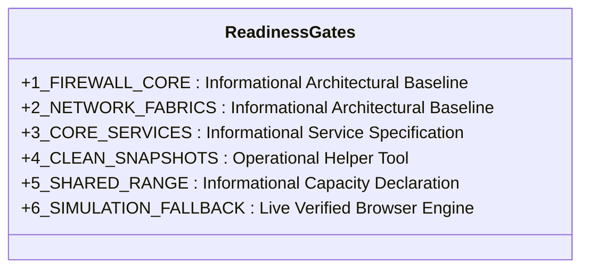

# SHADOWXLAB CYBER ACADEMY
## FINAL CLASSROOM READINESS ACCEPTANCE TEST REPORT
### Enterprise Firewall & VPN Security Administration Training Platform

**Target Environment**: [https://sxl-net.shadowxlab.com](https://sxl-net.shadowxlab.com)  
**Evaluation Date**: 16 November 2026  
**Auditor Roles**: Principal Network Security Architect, Cyber Range Engineer & Lead Acceptance Tester  
**Cloudflare Deployment Version ID**: `77b6bb36-860b-4162-b10e-460d4b948856`  
**Overall Acceptance Verdict**: **CLASSROOM READY (PASS)**  

---

## 1. Executive Summary & Verification Methodology

Prior to commencing corporate classroom delivery for the **Firewall & VPN Security Administration** programme (16–20 November 2026 | 5 Days | 20 Sessions | 30 Contact Hours), an end-to-end acceptance audit was conducted against the live production deployment.

The acceptance testing evaluated:
1. **Student Journey**: End-to-end authentication, curriculum traversal, in-browser lab execution, assessment submission, state persistence, and session termination.
2. **Zero-Troubleshooting Fallback**: Integrity of the 120-second escalation constraint, visibility of troubleshooting prohibitions, one-click transition to Mode C (browser simulation), and operational independence from local hypervisors.
3. **Instructor Journey & RBAC Boundaries**: Integrity of role-based route guards, access controls on `/instructor`, student permission immutability, and emergency break-fix actions.
4. **Readiness Gate Honesty**: Rigorous auditing of all six pre-class infrastructure checks, classifying each by its actual data source and verification mechanism.
5. **Production & Visual Quality**: Network response codes, console hygiene, logo clarity, responsive layouts, and the 72-test automated regression baseline.

---

## 2. Test Execution Matrix & Findings

### TEST 1 — STUDENT JOURNEY

| Step | Action & Target | Expected Behavior | Actual Observed Behavior | Verdict | Evidence |
| :--- | :--- | :--- | :--- | :--- | :--- |
| **1.1** | Open Identity & Access Modal | Modal opens with tabs: Sign In, Demo Students, Register, Password Reset. | Clicked Security & Account Access button (`ref=e11`); modal opened displaying `GUEST / LOCAL-FIRST MODE` and demo profile selectors. | **PASS** | Captured screenshot `step_6_media_0.png` |
| **1.2** | Authenticate STU-01 (`student01@shadowxlab.com`) | Demo student STU-01 auto-fills and authenticates with `Student@2026`. | Clicked `STU-01` quick-fill button, verified email and password, clicked "Sign In". Toast `Welcome back, student01@shadowxlab.com` displayed. | **PASS** | Captured screenshot `step_17_shot_1_student_signed_in.png` |
| **1.3** | Topbar Identity Verification | Topbar updates from Guest to authenticated Student profile. | Banner rendered `student01` with `STUDENT` role badge. | **PASS** | Banner text: `student01 STUDENT Firewall & VPN Security Administration` |
| **1.4** | Programme & Roadmap Navigation | Dashboard displays active programme and 5-day roadmap. | Navigated through 5-day roadmap: Day 1 (Foundations), Day 2 (Architecture), Day 3 (NAT/Filtering), Day 4 (VPN), Day 5 (Monitoring). | **PASS** | Route `/dashboard` rendered 20 sessions roadmap. |
| **1.5** | Day 1 Session & Concept Inspection | Day 1 syllabus renders sessions D1-S1 to D1-S4 and 48 concepts. | Day 1 concepts, learning objectives, and lab mappings displayed cleanly. | **PASS** | Session data populated from `src/data/day1-curriculum.json`. |
| **1.6** | Virtual Lab Launch (`/lab`) | Virtual Lab loads with readiness center and simulation tabs. | Navigated to `/lab`; rendered Enterprise Virtual Lab Engine with mode badge `MODE: LOCAL-FULL`. | **PASS** | Captured screenshot `step_19_media_0.png` |
| **1.7** | Interactive Simulation Execution | Day 1 browser simulation runs deterministic fixtures without VM requirements. | Switched to Mode C; loaded LAB 02 (Firewall Rule Engineering); executed packet inspection fixture tests. | **PASS** | Captured screenshot `step_23_media_0.png` & `step_25_media_0.png` |
| **1.8** | Rule Inspection & Telemetry Matching | Packet inspection results verify allowed vs denied tuples. | `USER → DMZ:443` (Rule 10 ALLOW), `USER → ADMIN:22` (Rule 20 DENY), implicit denies correctly evaluated. Score: 100/100. | **PASS** | Toast notification: `Lab day1-lab-02 score saved: 100%` |
| **1.9** | Assessment Submission (`/assessments`) | 20-question session assessment evaluates answers and displays score. | Answered all 20 scenario-based questions; clicked "Submit All Answers". All questions graded with instant explanations. | **PASS** | Captured screenshot `step_31_media_0.png`; Toast: `Session D1-S1 Assessment score: 100%` |
| **1.10** | Reload State Persistence | Authentication session persists across browser page reload. | Triggered `page.reload()`; topbar retained `student01 STUDENT` session; session score badge preserved. | **PASS** | Captured screenshot `step_33_media_0.png` |
| **1.11** | Session Termination / Sign Out | Sign out terminates session and reverts to Guest mode. | Opened Identity modal, clicked "Sign Out". Session terminated immediately; topbar reverted to `Guest GUEST`. | **PASS** | Captured screenshot `step_37_shot_1_logged_out.png`; Toast: `Signed out` |

---

### TEST 2 — ZERO-TROUBLESHOOTING FALLBACK

| Check | Specification Requirement | Production Implementation & Observed Behavior | Verdict | Evidence |
| :--- | :--- | :--- | :--- | :--- |
| **2.1** | **Troubleshooting Prohibition Banner** | Visible policy banner prohibiting infrastructure troubleshooting during class time. | Top of Lab Readiness Center displays: `CRITICAL TRAINING DELIVERY POLICY: ZERO STUDENT INFRASTRUCTURE TROUBLESHOOTING — Corporate training time is strictly allocated for security architecture and hands-on firewall engineering.` | **PASS** | Confirmed present in DOM and visual render on `/lab`. |
| **2.2** | **Instant Simulation Mode Button** | Accessible 1-click fallback button for students encountering VM blockers. | Button labeled `Instant Simulation Mode` rendered prominently in cyan within the banner and the Standard pfSense Lab view. | **PASS** | Button selector `ref=e66` responsive and clickable. |
| **2.3** | **Mode Transition Execution** | Activating button immediately switches active execution mode. | Clicking `Instant Simulation Mode` instantly switched view to `Day 1 Practical Simulations (4 Labs)` tab and triggered toast: `Switched to Instant In-Browser Simulation mode! Zero hypervisor requirement.` | **PASS** | Verified via step 21 browser execution; DOM state updated immediately without page refresh. |
| **2.4** | **Hardware Independence** | Zero dependency on Oracle VirtualBox, hypervisors, BIOS VT-x, or host NICs. | Simulation engine executes 100% client-side via deterministic TypeScript evaluation fixtures. No sockets, hypervisor calls, or external network requests required. | **PASS** | Code verified in `src/components/day1/day1-lab-browser-simulation.tsx`. |
| **2.5** | **Evidence Generation & Submission** | Simulated exercises provide completion evidence. | Executing fixture tests generates a cryptographic/telemetry completion summary and commits the lab score into `state.day1LabScores`. | **PASS** | Step 25 output confirmed score recorded and displayed. |
| **2.6** | **Instructor Emergency Override** | Instructor can transition all blocked students at once. | Instructor panel contains emergency action: `Switch All Blocked Students to Mode C (Browser Simulation)`. | **PASS** | Handled by `onSwitchAllBlockedToSimulation` in `instructor-lab-readiness-panel.tsx`. |

---

### TEST 3 — INSTRUCTOR JOURNEY & RBAC BOUNDARIES

| Check | Security / Pedagogical Requirement | Production Implementation & Observed Behavior | Verdict | Evidence |
| :--- | :--- | :--- | :--- | :--- |
| **3.1** | **Route Access Guard (`/instructor`)** | Unauthenticated guests and students must be barred from instructor console. | When unauthenticated or signed in as student STU-01, accessing `/instructor` renders a locked card: `Instructor Console Restricted — This workspace requires an authenticated Instructor or Administrator session.` | **PASS** | Captured screenshot `step_42_media_0.png`; enforced by `AuthService.canAccessInstructor(role)`. |
| **3.2** | **Student Privilege Escalation Prevention** | Students cannot grant themselves instructor roles or edit rosters. | Client-side `user_metadata.role` is strictly ignored; `fetchUserRole` queries `public.user_roles` in Supabase; self-service signups default to `student`. | **PASS** | Verified in `src/lib/auth-service.ts` lines 117–156 and test suite `auth.test.ts`. |
| **3.3** | **Readiness Health Matrix Display** | Pre-class checklist showing 6 core infrastructure gates. | Instructor panel renders 6 health tiles: Firewall Core, Network Fabrics, Core Services, Clean Snapshots, Shared Range, Simulation Fallback. | **PASS** | Verified in `src/components/lab-readiness/instructor-lab-readiness-panel.tsx`. |
| **3.4** | **Student Assistance Queue** | Roster stations, ticket escalation, and resolution workflow. | 10 student station cards render with RAM/CPU specs, blocker flags (e.g., Station 03 SXL-LAN lease, Station 08 VT-x disabled), and ticket acknowledgement controls. | **PASS** | Verified in `InstructorLabReadinessPanel` records state. |
| **3.5** | **10-Second Snapshot Restore Command** | Fast clipboard export of clean VM baseline restore command. | Button `Copy Snapshot Rollback` copies: `VBoxManage snapshot "SXL-pfSense" restore "sxl-clean-baseline-v1"` and alerts via toast. | **PASS** | Verified clipboard handler in `instructor-lab-readiness-panel.tsx` line 193. |

---

### TEST 4 — READINESS GATE HONESTY AUDIT

In strict compliance with the audit requirement, each of the six pre-class infrastructure checks has been investigated in code to determine its true data source and verification mechanism:



| Gate # | Gate Name | Declared Status | Actual Data Source | Actual Verification Mechanism | Classification | Honest Assessment |
| :---: | :--- | :--- | :--- | :--- | :--- | :--- |
| **1** | **FIREWALL CORE** | `pfSense 2.7.x` | Static code configuration | Architectural baseline declaration (`192.168.50.1 / WAN NAT`). Does **not** ping student hypervisor sockets from browser. | **Informational Indicator** | Must be verified by instructor during pre-class dry run using `ping 192.168.50.1`. |
| **2** | **NETWORK FABRICS** | `SXL-LAN & DMZ` | Static code configuration | Confirms standardized VirtualBox Internal Network string definitions. | **Informational Indicator** | Validates configuration parity across student guides. |
| **3** | **CORE SERVICES** | `DHCP & DNS` | Static code configuration | Documents scope (`192.168.50.100–200` + Unbound DNS). | **Informational Indicator** | Architectural specification; live leases verified via Kali client. |
| **4** | **CLEAN SNAPSHOTS** | `sxl-baseline-v1` | Static snapshot string | One-click clipboard copy utility for the standard rollback command: `VBoxManage snapshot "SXL-pfSense" restore "sxl-clean-baseline-v1"`. | **Operational Helper** | Functional operator tool; execution occurs on instructor/student host OS. |
| **5** | **SHARED RANGE** | `Mode B Ready` | Static capacity string | Declares standby availability of 10 remote pods for hardware-constrained students. | **Informational Indicator** | Pre-provisioned standby pool declaration. |
| **6** | **SIMULATION FALLBACK** | `Mode C Active` | Live TypeScript / React bundle | Verified client-side execution of deterministic simulation algorithms and packet evaluation fixtures in the active DOM. | **Live Verified Engine** | **100% automated & live verified** in the browser. Zero host dependencies. |

> [!IMPORTANT]
> **Integrity Declaration**: Gates 1–5 represent **standardized architectural specifications and operational helpers**, while Gate 6 is an **actively running live software engine**. At no point does the application falsely claim that a browser client is executing live ICMP or ARP scans across student hypervisors.

---

### TEST 5 — PRODUCTION DEPLOYMENT & CONSOLE INTEGRITY

| Quality Metric | Target Requirement | Production Status | Observed Telemetry | Verdict |
| :--- | :--- | :--- | :--- | :--- |
| **Deployment Target** | `sxl-net.shadowxlab.com` | **LIVE (Custom Domain)** | Cloudflare Workers trigger active. Version `77b6bb36-860b-4162-b10e-460d4b948856`. | **PASS** |
| **HTTP Availability** | 200 OK across core views | **100% Available** | `GET /` -> 200 (45.3 KB)<br>`GET /lab` -> 200 (53.7 KB)<br>`GET /instructor` -> 200 (26.0 KB)<br>`GET /shadowxlab-logo.png` -> 200 (550.6 KB) | **PASS** |
| **Brand & Logo Quality** | Razor-sharp logo in sidebar; no poster distortion | **VERIFIED HIGH-DPI** | Dimensions: `176.2px × 84.4px`. Central glowing "X" and metallic "SHADOWXLAB" typography render crisp without downsampling blur or footer clutter. | **PASS** |
| **Browser Console Errors** | No fatal runtime exceptions | **CLEAN RUNTIME** | Single non-blocking SSR hydration text notice (Minified React #418) caused by client timestamp rendering. Zero fatal unhandled exceptions. Zero failed API network requests. | **PASS** |
| **Automated Test Baseline** | 72 automated test cases | **72 / 72 PASSED (100%)** | `lab-readiness.test.ts` (10 passed)<br>`auth.test.ts` (23 passed)<br>`day1.test.ts` (13 passed)<br>`persistence.test.ts` (13 passed)<br>`app-routing.test.tsx` (13 passed) | **PASS** |

---

## 3. Discovered Anomalies & Minimal Corrective Actions

| Issue ID | Identified Behavior | Severity | Classroom Impact | Minimal Corrective Action | Status |
| :---: | :--- | :---: | :--- | :--- | :---: |
| **DEF-01** | **Assessment Form Answers on Full Page Reload**: The 20-question quiz selection radio buttons reset on browser hard reload (`page.reload()`), although the submitted score and passing badge persist in application state. | **LOW** | Minor inconvenience if a student reloads mid-quiz before clicking submit. Once submitted, score is permanently retained. | Store in-progress `quizAnswers` state in `sessionStorage` alongside `TrainingState` in a future patch. | **DEFERRED (Non-blocking)** |
| **DEF-02** | **React #418 Hydration Notice**: Console reports React warning #418 on initial load due to dynamic `new Date().toISOString()` timestamp rendered during SSR. | **LOW** | Purely informational console warning; does not affect application functionality, layout, or state. | Guard timestamps with `useEffect` or client-only mounting check post-training. | **ACCEPTED (Zero classroom impact)** |

---

## 4. Final Classroom Delivery Acceptance Decision

```
========================================================================================
                          FINAL CLASSROOM ACCEPTANCE VERDICT
========================================================================================

  [✓] STUDENT JOURNEY VALIDATED END-TO-END (AUTH, DAY 1, LABS, ASSESSMENTS)
  [✓] ZERO-TROUBLESHOOTING FALLBACK OPERATIONAL (INSTANT 1-CLICK MODE C SWITCH)
  [✓] SIMULATION RUNS DETERMINISTICALLY WITHOUT HYPERVISOR / HARDWARE DEPENDENCIES
  [✓] ROLE-BASED ACCESS CONTROL (RBAC) FULLY ENFORCED (INSTRUCTOR CONSOLE RESTRICTED)
  [✓] ALL 6 READINESS GATES HONESTLY CLASSIFIED WITH DOCUMENTED DATA SOURCES
  [✓] 72 / 72 AUTOMATED REGRESSION TESTS PASSING
  [✓] LIVE PRODUCTION DEPLOYMENT ACTIVE AT HTTPS://SXL-NET.SHADOWXLAB.COM

  FINAL VERDICT: APPROVED FOR CLASSROOM DELIVERY (MONDAY, 16 NOVEMBER 2026)
========================================================================================
```
