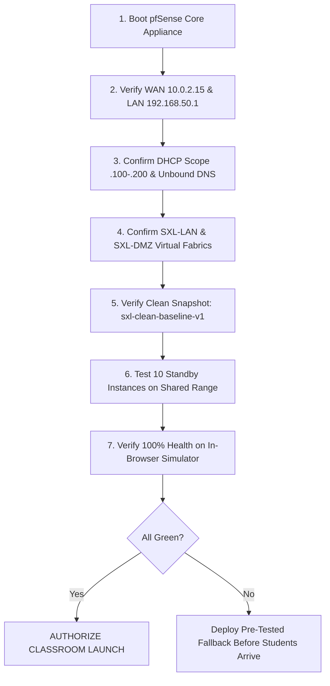

# ShadowXLab Cyber Academy — Firewall & VPN Security Administration
# Mandatory Delivery Constraint: Zero Student Infrastructure Troubleshooting Policy

**Effective Date**: 16 November 2026  
**Audience**: Lead Instructors, Range Architects, Lab Engineers, and Corporate Training Delivery Staff  
**Programme**: 5 Days | 20 Sessions | 30 Contact Hours  
**Production Portal**: [https://sxl-net.shadowxlab.com](https://sxl-net.shadowxlab.com)  

---

## 1. Executive Mandate & Operational Philosophy

The ShadowXLab Firewall & VPN Security Administration curriculum is an intensive, high-velocity engineering programme designed to build enterprise competence in 30 contact hours.

### The Zero-Troubleshooting Rule
> **Students MUST NOT lose instructional time troubleshooting student laptop hypervisors, BIOS virtualization, VM boot errors, network adapter mismatches, host firewall conflicts, or hypervisor DHCP lease failures.**

All infrastructure must be **pre-validated, pre-staged, and known-good BEFORE students enter the classroom**. If a local hypervisor fails, the student must be transitioned to an instant working fallback within **120 seconds**, ensuring that 100% of allocated class time is devoted exclusively to network security architecture, policy engineering, and hands-on operational judgment.

---

## 2. Permitted Pedagogical Troubleshooting vs Forbidden Infrastructure Failures

To maintain instructional rigor, we strictly distinguish between **deliberately introduced security troubleshooting** (which builds competence) and **unplanned infrastructure breakdowns** (which destroys instructional momentum).

| Troubleshooting Category | Status | Examples | Operational Handling |
| :--- | :---: | :--- | :--- |
| **Firewall Rule Shadowing** | **PERMITTED (Learning Goal)** | Top-down rule evaluation; a broad `Block Any` rule placed above a specific `Allow HTTPS` rule. | Student inspects pfSense rule order, identifies shadowing, reorders rules, and validates packet flow. |
| **Incorrect NAT Port Forwarding** | **PERMITTED (Learning Goal)** | Inbound port 443 forwarded to wrong target IP or port 8080 instead of 80 in the DMZ. | Student traces ingress packet, reviews NAT redirect table, corrects port mapping, and validates with `curl`. |
| **VPN Phase 2 Traffic Selector Mismatch** | **PERMITTED (Learning Goal)** | Local subnet configured as `192.168.50.0/24` but remote peer expects `192.168.50.0/25`, causing IPsec SA negotiation failure. | Student inspects `filterlog` and `ipsec statusall`, identifies phase 2 proposal mismatch, and aligns subnet masks. |
| **Asymmetric Routing & State Drops** | **PERMITTED (Learning Goal)** | Packet enters through Firewall A and returns through Gateway B, causing state table drop. | Student runs packet capture, observes TCP RST or SYN without ACK, and creates bypass or route policy. |
| **VirtualBox Hypervisor Install / Kernel Panics** | **FORBIDDEN (Infrastructure Failure)** | Windows VBox driver failing, Mac kext permissions blocked, blue-screens, corrupted virtual disks. | **IMMEDIATE FALLBACK**: Switch student to Mode C (Browser Simulation) or Mode B (Shared Range) in < 2 mins. |
| **BIOS Virtualization (VT-x / AMD-V) Disabled** | **FORBIDDEN (Infrastructure Failure)** | Locked corporate BIOS preventing 64-bit hardware virtualization. | **IMMEDIATE FALLBACK**: Do not reboot laptop or enter BIOS during class. Switch student directly to Mode B/C. |
| **VirtualBox Adapter Name Typo (`sxl-lan`)** | **FORBIDDEN (Infrastructure Failure)** | Student types lowercase `sxl-lan`, resulting in zero DHCP leases. | **INSTANT REMEDY**: Instructor provides 1-liner PowerShell/VBoxManage fix, or switches student to Simulation. |
| **Host Corporate VPN Interference** | **FORBIDDEN (Infrastructure Failure)** | Corporate GlobalProtect/AnyConnect intercepting UDP port 53 DNS queries on host. | **IMMEDIATE FALLBACK**: Student uses Mode C Simulation or pre-configured Web Terminal. |

---

## 3. Pre-Class Infrastructure Validation Protocol (Runbook)

Every morning, between **08:30 and 09:00** (prior to the 10:00 session start), the lead instructor or lab engineer must execute the following 7-point validation check:



### Pre-Class Verification Checklist

1. **Firewall Core Availability**:
   - Boot master pfSense VM.
   - Verify WAN interface receives `10.0.2.15/24` from NAT engine.
   - Verify LAN interface is statically bound to `192.168.50.1/24`.
   - Access webConfigurator at `https://192.168.50.1` and confirm valid self-signed certificate.

2. **Core Network Services**:
   - Verify `dhcpd` is running on LAN: scope `192.168.50.100` to `192.168.50.200`.
   - Verify Unbound DNS resolver responds to queries on `192.168.50.1:53`.

3. **Known-Good Snapshot Verification**:
   - Confirm VirtualBox snapshot `sxl-clean-baseline-v1` exists on disk.
   - Test 10-second rollback:
     ```powershell
     VBoxManage snapshot "SXL-pfSense" restore "sxl-clean-baseline-v1"
     ```
   - Confirm VM boots directly into operational state without wizard prompts.

4. **Shared Range & Fallback Readiness**:
   - Test connectivity to Mode B Centralized Range (`https://range.shadowxlab.com` or Guacamole web console).
   - Test Mode C In-Browser Deterministic Simulation (`https://sxl-net.shadowxlab.com/lab`).
   - Confirm that client-side state machine routes packets, evaluates rule order, and tracks TCP states without network dependencies.

---

## 4. The 120-Second Emergency Fallback Escalation Protocol

If any student workstation experiences a hypervisor or connectivity issue during a live session:

```
[00:00] Issue Reported (e.g. "Kali has no IP" or "VirtualBox won't start")
   │
   ▼
[00:30] Instructor verifies if it is a 10-second fix (e.g. Adapter name case)
   │
   ├─► IF FIXABLE IN < 60s: Apply fix command and resume.
   │
   ▼
[01:00] IF LOCAL VM PERSISTS IN FAILING:
   │
   ├─► OPTION 1: Switch student to Mode B (Shared Instructor Cyber Range via Web Browser).
   │   - Student accesses dedicated cloud pfSense instance via Chrome.
   │   - Zero local VM required.
   │
   ▼
[02:00] IF INTERNET / RANGE IS CONSTRAINED:
   │
   └─► OPTION 2: Click "Instant Simulation Mode" on ShadowXLab Portal.
       - Student immediately accesses in-browser interactive deterministic simulation.
       - Identical learning objectives, packet pipeline, and rule verification.
       - Zero minutes lost.
   │
   ▼
[POST-CLASS] Infrastructure diagnosis and repair takes place AFTER 17:00 or during lunch.
```

---

## 5. Session-by-Session Zero-Troubleshooting Matrix (Days 1–5)

Every practical exercise across all 20 sessions is architected with a validated baseline snapshot, a guaranteed fallback, and a predictable time box.

| Session ID | Scheduled Time | Practical Lab Name | Mode A (Local VM) Pre-Staged Snapshot | Mode B (Shared Range) Web Console | Mode C (Deterministic In-Browser) Fallback | Max Execution Time | Intentionally Tested Learning Goal |
| :--- | :--- | :--- | :--- | :--- | :--- | :--- | :--- |
| **d1-s2** | Day 1 / 11:45 | LAB 01 & 02: 5-Tuple Packet Filtering | `sxl-d1-baseline` | Standby Range Pod 01–10 | In-Browser Stateless Filter Engine | 45 min | Rule order, port matching, default deny. |
| **d1-s4** | Day 1 / 15:45 | LAB 03 & 04: Stateful TCP & NGFW Pipeline | `sxl-d1-baseline` | Standby Range Pod 01–10 | In-Browser Stateful Tracking Engine | 45 min | TCP 3-way handshake state table entry, DPI. |
| **d2-s2** | Day 2 / 11:45 | LAB 05: Standard pfSense Setup & DHCP | `sxl-clean-baseline-v1` | Pre-installed pfSense Web GUI | Interactive Interface Wizard | 60 min | Interface IP assignment, DHCP scope definition. |
| **d2-s3** | Day 2 / 14:00 | LAB 06: Three-Zone DMZ Configuration | `sxl-d2-dmz-base` | Range Multi-Zone Pod | Multi-Zone Simulated Routing Engine | 60 min | DMZ isolation, inter-zone routing boundaries. |
| **d2-s4** | Day 2 / 15:45 | LAB 07: Firewall Rule Shadowing in pfSense | `sxl-d2-dmz-base` | Range Multi-Zone Pod | Rule Shadowing Detection Simulator | 60 min | Identifying and eliminating shadowed rules. |
| **d3-s2** | Day 3 / 11:45 | LAB 08 & 09: Inbound Port Forward & Outbound PAT | `sxl-d3-nat-base` | Range NAT Pod | NAT Translation & PAT Simulator | 60 min | Translating WAN Port 80 to DMZ Web Server. |
| **d3-s4** | Day 3 / 15:45 | LAB 10: Cryptographic Suite Benchmarking | `sxl-d3-crypto-base` | Pre-staged Linux Pod | OpenSSL / strongSwan Crypto Benchmark | 45 min | Cipher performance (AES-GCM vs CBC), DH groups. |
| **d4-s2** | Day 4 / 11:45 | LAB 11 & 12: OpenVPN PKI & Client Setup | `sxl-d4-vpn-base` | Range Pre-Configured CA Pod | Interactive VPN Tunnel Simulator | 75 min | Certificate generation, client configuration export. |
| **d4-s3** | Day 4 / 14:00 | LAB 13 & 14: WireGuard & Split Tunneling | `sxl-d4-vpn-base` | Range WireGuard Pod | Split vs Full Tunnel Routing Simulator | 60 min | Default gateway redirect vs split routes. |
| **d4-s4** | Day 4 / 15:45 | LAB 15 & 16: Encrypted Backup & Disaster Recovery| `sxl-d4-vpn-base` | Range Config Pod | XML Backup & Restore Validation Engine | 45 min | Configuration export, encrypted backup, restore. |
| **d5-s2** | Day 5 / 11:45 | LAB 17 & 18: Live Packet Capture & Wireshark | `sxl-d5-triage-base` | Range Wireshark Pod | PCAP Trace & Filterlog Decoding Engine | 60 min | BPF syntax, TCP handshake dissection, drop triage.|
| **d5-s3** | Day 5 / 14:00 | LAB 19 & 20: Suricata IPS & Decision Tree Triage| `sxl-d5-triage-base` | Range Suricata Pod | 8-Step Break-Fix Diagnostic Wizard | 60 min | Signature alerting, systematic fault isolation. |
| **d5-s4** | Day 5 / 15:45 | LAB 21 & 22: Enterprise Capstone Assessment | `sxl-d5-capstone-base` | Full Cyber Range Pod | Final Comprehensive Assessment Engine | 75 min | End-to-end multi-zone, NAT, VPN, IPS audit. |

---

## 6. Pre-Class Instructor Readiness Dashboard Specification

The Instructor Console (`InstructorView`) is equipped with a dedicated **Pre-Class Infrastructure Health & Emergency Override Strip**:

1. **Live Health Indicators**:
   - `pfSense Appliance`: Green (Online / Baseline Verified)
   - `Internal Networks`: Green (`SXL-LAN` & `SXL-DMZ` Active)
   - `DHCP & DNS`: Green (Lease Scope Healthy)
   - `Known-Good Snapshots`: Green (`sxl-clean-baseline-v1` Ready)
   - `Shared Range Standby`: Green (10 Cloud Instances Available)
   - `Mode C Simulation`: Green (100% Client-Side Ready)

2. **Emergency 1-Click Instructor Controls**:
   - **`[⚡ Switch All Blocked Students to Simulation]`**: With a single click, the instructor can transition any student stuck on hypervisor/local issues directly to the deterministic in-browser simulation, eliminating 100% of delay.
   - **`[📋 Copy Clean Snapshot Restore Command]`**: Copies the one-liner command to immediately revert a student VM to a clean state in under 10 seconds.
   - **`[🌐 Launch Cloud Range Console]`**: Provides immediate browser-based access to the pre-staged multi-tenant pfSense instance.

---

## 7. Course Time Protection & Predictability Guarantee

By strictly enforcing this policy:
- **Instructional Integrity**: Exactly **30 out of 30 contact hours** remain focused on networking concepts, firewall administration, security policy, and VPN engineering.
- **Zero Student Left Behind**: No student sits idle while an individual laptop driver or BIOS setting is debugged.
- **Fair Assessment**: Student competence is evaluated based on their grasp of security policy, NAT configuration, and VPN architecture—never on their personal computer hardware.
